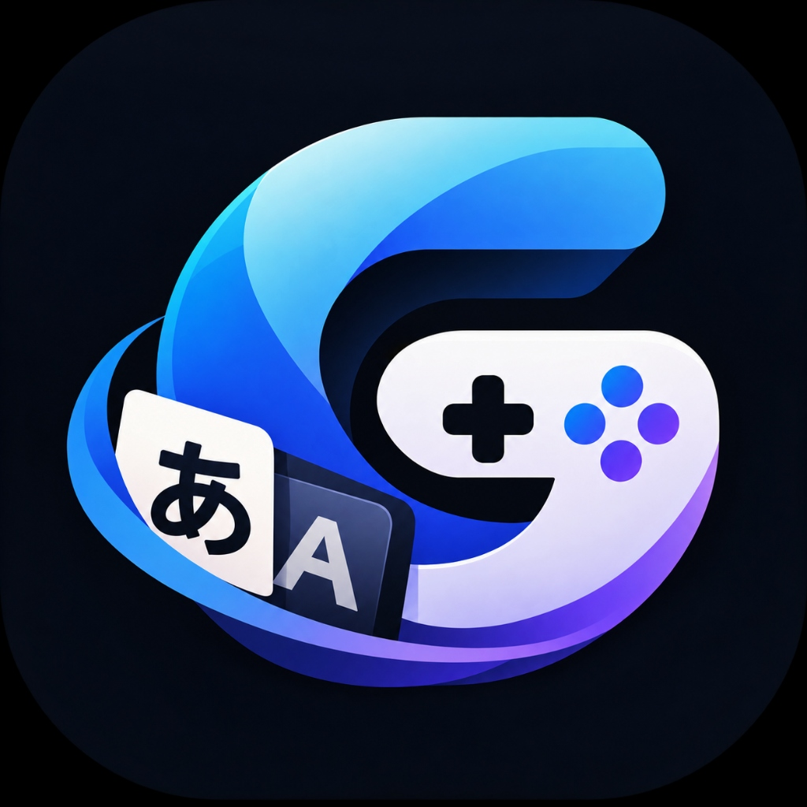

<p align="center">
  
</p>

# GameLingo

GameLingo is a local-first Windows desktop workbench for translating game text into playable, editable translations. It safely extracts text from game data files, translates strings using local neural machine translation, provides a human review and spreadsheet interchange interface, and generates verified translation patches with isolated backups and one-click rollback.

---

## 1. Vision & Core Principles

- **Local-First & Offline:** Runs entirely on your machine. Once installed, translation and patching require zero internet access.
- **Zero-Cost:** No paid APIs, cloud services, external databases, or subscriptions.
- **Safety by Default:** Never silently overwrites game files. Pre-patch manifests, atomic staging, automatic rollback, and full restore capabilities ensure original game files remain protected.
- **Human-in-the-Loop:** Machine translations are treated as draft text. Approval gates and quality validation prevent unverified machine output from deploying into games.

---

## 2. Supported Game Engines

| Engine | Source Formats | Output Format | Capabilities & Constraints |
| :--- | :--- | :--- | :--- |
| **RPG Maker MV & MZ** | `data/*.json`, `www/data/*.json` | Serialized Engine JSON | Extracts dialogue, names, descriptions, common events, and map info. Patches modify JSON data with isolated backup. Encrypted assets (`.rpgmvp`) must be decrypted prior to translation. |
| **Ren'Py Visual Novels** | `game/**/*.rpy` (scripts), `game/*.rpa` archives (RPA-3.0, RPA-2.0, RPA-1.0), compiled `*.rpyc` | `game/tl/<lang>/strings.rpy` | Extracts dialogue, narration, and choices from loose `.rpy` scripts, read-only `.rpa` archives, or compiled `.rpyc` files (via pure-Python `rpycdec`). Applies deterministic precedence (`loose .rpy` > `loose .rpyc` > `archive .rpy` > `archive .rpyc`). Generates non-destructive native Ren'Py string translations without altering original archives or script files. Optional language activation script (`gamelingo_activate.rpy`). |

### Out of Scope
- Save file editing and live memory injection.
- OCR / real-time screen overlays.
- Binary media asset editing (audio, images, videos, fonts, executables).

---

## 3. Features

- **Desktop UI & CLI:** Modern PySide6 dark-graphite desktop interface and full-featured command-line interface.
- **Smart Text Extraction:** Preserves hierarchical locators, character tags, and scene context.
- **Placeholder & Markup Protection:** Detects and protects variable interpolation (`\N[1]`, `%1`, `[player_name]`), formatting tags (`\C[0]`, `{i}`, `{b}`, `{color=...}`), and escaped control characters.
- **Local Machine Translation:** Integrated offline translation powered by Argos Translate (CTranslate2 NMT runtime).
- **Translation Memory & Deduplication:** Caches translated units in a local SQLite database to prevent duplicate work.
- **Review & Quality Validation:** Split-view review interface with search, status filtering, warning checks (length mismatch, corrupted placeholders, untranslated Japanese text), and approval actions.
- **Spreadsheet Interchange:** UTF-8-BOM CSV export/import compatible with Microsoft Excel, featuring formula-injection protection and immutable metadata validation.
- **Safety Engine:** Atomic write staging (`gamelingo_*.tmp`), UUID-isolated backup snapshots, post-write SHA-256 verification, automatic rollback on partial failure, and byte-for-byte restoration.

---

## 4. Installation & Windows Portable Release

Pre-built portable releases are available on the [GitHub Releases](https://github.com/kunal-gswm/GameLingo/releases) page.

1. **Download:** Download `GameLingo.exe` or `GameLingo-Windows-x64.zip` (also available as `GameLingo-v0.1-windows-x64.zip`) and `SHA256SUMS.txt`.
2. **Verify Checksum:** Open PowerShell in your download folder and verify the archive hash:
   ```powershell
   Get-FileHash GameLingo.exe -Algorithm SHA256
   Get-FileHash GameLingo-Windows-x64.zip -Algorithm SHA256
   Get-Content SHA256SUMS.txt
   ```
3. **Extract:** If using the ZIP archive, extract to a writable location (e.g., `C:\Tools\GameLingo\` or your Documents folder). Do not extract inside `Program Files` or system directories requiring elevated permissions.
4. **Launch:** Double-click `GameLingo.exe`.
   - *Windows SmartScreen Note:* Because GameLingo is an unsigned open-source application, Windows SmartScreen may show a prompt ("Windows protected your PC"). Click **More info** $\rightarrow$ **Run anyway** after verifying the release source and checksum.

> [!TIP]
> For a comprehensive walkthrough on safe game copying, first-project translation, backup restoration, and bug reporting, see the [Public Beta Testing & Verification Guide](docs/user-guide/beta-testing-guide.md).

---

## 5. Quick Start

### Graphical Interface (GUI)
1. **Open Workspace:** Select or create a folder where GameLingo will store project databases and backups.
2. **Select Game Directory:** Choose the root directory of your RPG Maker MV/MZ or Ren'Py game. GameLingo will verify engine structure and report diagnostics.
3. **Extract Strings:** Navigate to the Extract page and click **Extract All Text**.
4. **Translate:** Navigate to the Translate page and start a translation job.
5. **Review:** Navigate to the Review page to inspect translations, edit text, and approve units.
6. **Patch:** Navigate to the Patch page, review the validated plan preview, and click **Apply Patch to Game**.

### Command-Line Interface (CLI)
```bash
# 1. Initialize a project workspace
gamelingo project init --workspace ./workspace

# 2. Inspect and detect game engine
gamelingo game detect "C:/Games/MyGame"

# 3. Extract translatable strings
gamelingo extract "C:/Games/MyGame"

# 4. Run translation job
gamelingo translate

# 5. Review translations or export to CSV
gamelingo review list --status needs_review,draft
gamelingo export csv --output translations.csv

# 6. Generate and preview patch plan
gamelingo plan create --plan-file patch.json
# (convenience alias: gamelingo patch plan --plan-file patch.json)

# 7. Apply patch with isolated backup
gamelingo apply patch.json --execute --yes
# (convenience alias: gamelingo patch apply patch.json --execute --yes)

# 8. Restore backup snapshot if needed
gamelingo restore <backup-id> --execute --overwrite
```

---

## 6. Translation Model Setup

GameLingo uses the open-source Argos Translate Japanese-to-English neural translation model (`ja -> en` v1.1, ~50MB).

- **Online Setup (One-Click):** On the GUI Translation page, click **Download & Install Model**. GameLingo will download and register the model from the official Argos index with explicit consent.
- **Offline Setup:** For air-gapped systems:
  1. Download the `translate-ja_en` package (`.argosmodel`) from [Argos Open Tech](https://www.argosopentech.com/).
  2. In the GUI Translation page, click **Install from Local File** and select the `.argosmodel` file.
- **Missing Model Behavior:** If the model is not installed, GameLingo runs normally for extraction, review, CSV editing, and patch application using pre-existing translations; translation generation will prompt for model installation.

---

## 7. Development & Testing

### Prerequisites
- Python 3.12 or newer
- [uv](https://github.com/astral-sh/uv) (fast Python package and environment manager)

### Local Setup
```bash
# Clone the repository
git clone https://github.com/kunal-gswm/GameLingo.git
cd GameLingo

# Install all dependencies (core, GUI, Argos, dev)
uv sync --locked --extra gui --extra argos --group dev

# Launch desktop GUI
uv run python -m gamelingo.gui.main

# Run the complete test suite
uv run pytest

# Check code formatting and linting
uv run ruff check .
uv run ruff format --check .
```

### Benchmarks
To compare translation models using the built-in 60-string game dialogue dataset:
```bash
uv sync --group benchmark
uv run python scripts/run_benchmark.py
```
Benchmark results are generated under `src/gamelingo/benchmark/results/`.

### Windows Package Build
To produce the standalone portable Windows package locally:
```powershell
powershell -ExecutionPolicy Bypass -File build_windows.ps1
```
The script compiles `dist\GameLingo-Windows-x64.zip` and generates `dist\GameLingo-Windows-x64.zip.sha256`.

---

## 8. Safety, Backups & Restoration

GameLingo enforces strict filesystem safety guarantees:

- **Isolated Backups:** Every patch operation creates a timestamped, UUID-isolated snapshot in `workspace/backups/<uuid>/` with a cryptographic `manifest.json`.
- **Atomic Staging:** Edits are written to temporary staging files (`gamelingo_*.tmp`) in the destination directory and validated before replacing originals.
- **Automatic Rollback:** If serialization, filesystem replacement, or post-write checksum verification fails, GameLingo catches the failure and immediately restores modified files to their pristine baseline.
- **One-Click Restore:** Revert patches at any time via the GUI Patch page or CLI:
  ```bash
  gamelingo restore <backup-id> --execute --overwrite
  ```
  Restoration returns original files to their exact pre-patch SHA-256 state and cleanly unlinks newly created translation or activation files.

---

## 9. Known Limitations & Troubleshooting

- **Antivirus Quarantines:** PyInstaller-bundled binaries may occasionally trigger false-positive heuristics on Windows. If `GameLingo.exe` fails to start, verify that bundled files in `_internal` were not blocked by security software.
- **Startup Diagnostics:** If the application crashes on launch, run `GameLingo.exe > crash_log.txt 2>&1` in PowerShell to capture stdout/stderr. Ensure directory paths do not exceed Windows' 260-character path limit.
- **Machine Translation Quality:** Raw neural machine translation may produce literal or stiff phrasing. Human review via the Review tab or CSV export is strongly recommended before patching.
- **Encrypted Game Archives:** RPG Maker MV/MZ games distributing encrypted assets (`.rpgmvp`, `.rpgmvo`) must be unpacked with an asset decrypter before GameLingo can parse JSON events.
- **Ren'Py SDK Verification:** Direct in-engine rendering via an official running Ren'Py SDK is not executed in headless CI environments and remains unverified. Translation files strictly comply with Ren'Py 8.x translation specifications.

---

## 10. Documentation & Release History

- **Product Requirements:** [`docs/product/PRD.md`](docs/product/PRD.md)
- **Milestone & Release History:** [`docs/history/MILESTONE_HISTORY.md`](docs/history/MILESTONE_HISTORY.md)
- **Ren'Py Support & Hardening Report:** [`docs/releases/GL_033_RenPy_Support_Report.md`](docs/releases/GL_033_RenPy_Support_Report.md)
- **Release Report Index:** [`docs/releases/README.md`](docs/releases/README.md)
- **Real-Game Harness Setup:** [`docs/development/pilot-harnesses.md`](docs/development/pilot-harnesses.md)

---

## 11. Contributing & License

Contributions, bug reports, and suggestions are welcome via [GitHub Issues](https://github.com/kunal-gswm/GameLingo/issues) and [Pull Requests](https://github.com/kunal-gswm/GameLingo/pulls).

- **License:** First-party code is licensed under the [MIT License](LICENSE).
- **Third-Party Notices:** Licenses for bundled and optional dependencies (PySide6, CTranslate2, Argos Translate, Stanza, etc.) are cataloged in [THIRD_PARTY_NOTICES.txt](THIRD_PARTY_NOTICES.txt).
