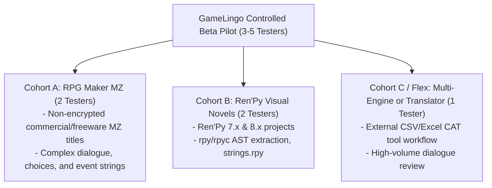
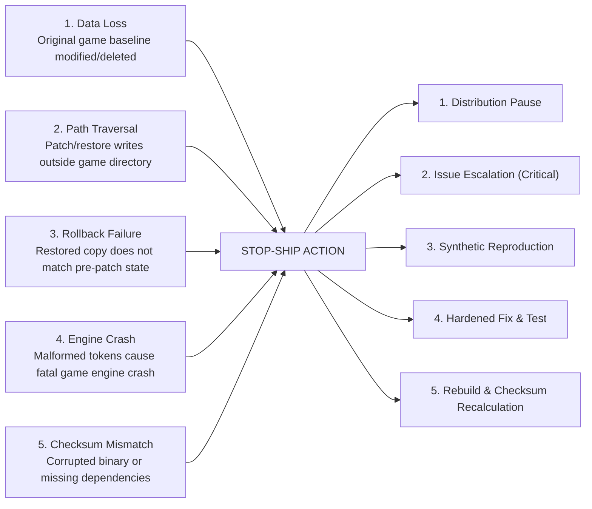

# GameLingo: Beta Pilot Operations & Feedback Tracker

**Task ID:** GL-BETA-006  
**Document Type:** Pilot Operations & Triage Protocol  
**Operational Status:** **`NOT YET RUN — RECRUITMENT PENDING`**  
**Audited Binary Build SHA:** `68e76c5b9678c187fcebdafc3cfbfe3b5c37cb80`  
**Distribution Artifact:** `dist/GameLingo-Windows-x64.zip` (SHA-256: `AFE97D26B253805EF0C33AEF055AA804132E83967F88B2EB79F245670796D1FA`)

---

## 1. Pilot Purpose & Governance

The GameLingo Controlled Beta Pilot is designed to gather qualitative and functional validation from external human testers on diverse Windows environments.

> [!IMPORTANT]
> **Automated Tests Do Not Equal Human Validation**  
> While GameLingo has passed 531 automated unit/integration tests, 28 GUI integration tests, and synthetic end-to-end runs, real-world translation involves varied screen resolutions, third-party plugin interactions, localized Windows path encodings, and human translation workflows.
> 
> The current pilot status is **`NOT YET RUN — RECRUITMENT PENDING`**. No external human validation is claimed until completed runs are logged in this document.

---

## 2. Tester Recruitment & Cohort Structure

The pilot engages **3 to 5 voluntary external testers** across two core cohorts corresponding to the Live-Runtime Verified engines:



### Ready-to-Share Invitation Copy

Below is the standard outreach text for recruiting pilot testers via GitHub Discussions, translation community Discords, and fan-translation forums:

````markdown
Subject: [Call for Testers] GameLingo v0.1.0-beta - Japanese Game Localization Tool

Hi everyone,

We are looking for 3–5 volunteer game translators, editors, or modders to test the v0.1.0 beta release of **GameLingo**—an open-source, local-first Windows desktop application for translating Japanese games.

### What is GameLingo?
GameLingo extracts translatable dialogue from game projects, provides an in-app split-screen translation and review interface with token-preservation guards (protecting `\C[n]`, `\V[n]`, `{b}`, etc.), supports CSV/Excel export/import, and safely applies translation patches with automatic, one-click rollback snapshots.

### Who can participate?
- **Cohort A:** Translators working on non-encrypted **RPG Maker MZ** titles.
- **Cohort B:** Translators working on **Ren'Py 7.x or 8.x** visual novels.
- **Requirements:** Windows 10/11 (64-bit), basic familiarity with game modding or fan translation. No coding or Python experience required!

### Testing Protocol & Safety:
- **The Golden Rule:** Testing must be performed strictly on a **dedicated copy** of your game—never on your primary or original install.
- **Copyright Protection:** Do NOT share or upload any commercial game files or copyrighted assets. Issues must be reported with synthetic examples or sanitized logs only.

### How to get started:
1. Review the Beta Testing Guide: [docs/user-guide/beta-testing-guide.md]
2. Download the portable zip from the release page and verify the SHA-256 checksum:
   `GameLingo-Windows-x64.zip`
   SHA-256: `AFE97D26B253805EF0C33AEF055AA804132E83967F88B2EB79F245670796D1FA`
3. Follow the test checklist and report findings using the GitHub Beta Issue Templates!

Thank you for helping make open-source game localization reliable and accessible.
````

---

## 3. Pilot Testing Matrix & Lifecycle Steps

Every pilot tester evaluates the complete 8-step lifecycle:

| Step | Operation | Success Criteria |
| :---: | :--- | :--- |
| **1. Install** | Installation & Checksum | Download `GameLingo-Windows-x64.zip`, compute SHA-256 in PowerShell, extract, and launch `GameLingo.exe` without missing DLL or dependency crashes. |
| **2. Extract** | String Extraction | Point GameLingo at dedicated game copy. Application correctly detects engine (MZ or Ren'Py) and extracts dialogue units into local workspace without crash. |
| **3. Tokens** | Token Guard Verification | Review strings containing escape codes (`\C[1]`, `\V[2]`, `\N[1]`, `{i}`, `[player]`). Modify translation; ensure editor warns if tokens are missing or malformed. |
| **4. CSV** | CSV Export & Re-Import | Export strings to CSV, open/edit in external editor (Excel / VS Code / LibreOffice), re-import CSV, confirm edits appear accurately in review table. |
| **5. Patch** | Patch Application & Snapshot | Generate patch plan from approved translations. Apply patch. Confirm GameLingo automatically creates pre-patch snapshot before writing any game file. |
| **6. In-Game** | In-Game Verification | Launch the patched game copy. Play to the translated scene. Confirm translated text renders properly without encoding mojibake or engine crash. |
| **7. Restore** | One-Click Restoration | In GameLingo, trigger Restore. Confirm game copy returns to pre-patch state. Re-launch game and confirm text is back to original Japanese. |
| **8. Disaster** | Recovery Verification | Verify that snapshot directory exists and original files can be manually restored even if GameLingo is closed. |

---

## 4. External Pilot Status Register

*Status Key:*
- `NOT STARTED` — Tester invited or slot open; testing has not commenced.
- `IN PROGRESS` — Testing actively underway.
- `PASS` — All 8 lifecycle steps completed successfully with verified results.
- `FAIL` — Blocker or bug encountered (linked to GitHub issue).
- `BLOCKED` — Testing blocked on external dependency or environment.

| Tester ID | Cohort | Engine & Target Profile | OS Version | 1. Install | 2. Extract | 3. Tokens | 4. CSV | 5. Patch | 6. In-Game | 7. Restore | 8. Recovery | Overall Status | Notes / Issues |
| :--- | :--- | :--- | :--- | :---: | :---: | :---: | :---: | :---: | :---: | :---: | :---: | :---: | :--- |
| **T-MZ-01** | Cohort A | RPG Maker MZ (Standalone/Demo) | Windows 11 x64 | — | — | — | — | — | — | — | — | `NOT STARTED` | Recruitment pending |
| **T-MZ-02** | Cohort A | RPG Maker MZ (Custom Plugins) | Windows 10 x64 | — | — | — | — | — | — | — | — | `NOT STARTED` | Recruitment pending |
| **T-RP-01** | Cohort B | Ren'Py 8.x Visual Novel | Windows 11 x64 | — | — | — | — | — | — | — | — | `NOT STARTED` | Recruitment pending |
| **T-RP-02** | Cohort B | Ren'Py 7.x Legacy Visual Novel | Windows 10 x64 | — | — | — | — | — | — | — | — | `NOT STARTED` | Recruitment pending |
| **T-FL-01** | Cohort C | Multi-Engine / CAT Workflow | Windows 11 x64 | — | — | — | — | — | — | — | — | `NOT STARTED` | Recruitment pending |

---

## 5. Stop-Ship Rules & Incident Protocol

A **Stop-Ship** condition is a high-severity failure that immediately halts distribution of the current beta build to prevent user data loss or widespread disruption.

### Stop-Ship Criteria

Any of the following 5 conditions triggers an immediate stop-ship action:



1. **Rule 1: Data Loss or Original File Corruption**  
   Any modification, truncation, or deletion of files outside the user's explicit translation target, or any failure to preserve the pre-patch backup snapshot.
2. **Rule 2: Path Traversal / Boundary Escape**  
   Any attempt by GameLingo (during extraction, export, patch, or restore) to read or write files outside the selected workspace and game project root directory.
3. **Rule 3: Misleading Restore or Broken Rollback**  
   Any scenario where the Restore command reports success, but the game directory is not bit-for-bit identical to its pre-patch state, or where restore fails leaving an unplayable or partially patched game.
4. **Rule 4: Fatal Control Token or Syntax Corruption**  
   Any bug in token preservation or AST reconstruction that produces unparseable game files causing the target game engine to crash or hang on boot.
5. **Rule 5: Distribution Checksum or Integrity Failure**  
   Any hash mismatch between published `SHA256SUMS.txt` and distributed artifacts, or any missing runtime dependency causing instant startup termination on clean Windows systems without a descriptive error.

### Stop-Ship Operational Response Procedure

When a stop-ship condition is reported:
1. **Immediate Distribution Pause:**
   - Add a prominent warning notice to repository README and Release Notes marking the build as suspended.
   - Halt distribution and advise existing testers to avoid patching active projects.
2. **Issue Escalation:**
   - Triage issue as `severity: critical` and label `stop-ship`.
   - Contact reporting tester for environment details and sanitized reproduction logs.
3. **Synthetic Reproduction:**
   - Reproduce the defect using a sanitized, non-copyrighted synthetic test fixture in the automated test suite.
4. **Engineering Fix & Regression Guard:**
   - Implement the fix in source code.
   - Add a dedicated fail-closed automated test preventing future regression.
5. **Rebuild & Re-Verification:**
   - Re-run full test suite (`uv run pytest`, GUI integration, release gate).
   - Rebuild Windows executable from the new hardened source commit.
   - Recalculate all artifact SHA-256 checksums and update `SHA256SUMS.txt`.
   - Resume pilot testing only after clean verification.

---

## 6. Feedback Triage Protocol

All incoming beta reports must follow the structured triage levels:

| Priority | Criteria | SLA / Action |
| :--- | :--- | :--- |
| **Critical (P0)** | Stop-Ship conditions: data loss, sandbox escape, broken restore, fatal crash. | Immediate distribution pause; fix within 24–48 hours. |
| **High (P1)** | Live-engine failure on supported MZ/Ren'Py: extraction missing dialogue, CSV import corruption, UI freeze during translation. | Triage within 24 hours; fix before expanding pilot. |
| **Medium (P2)** | Usability issues: table sorting glitch, confusing review status chips, non-critical warning display error. | Queue for next minor beta iteration. |
| **Low (P3)** | Minor cosmetic flaws, spacing inconsistencies, feature requests for unsupported formats. | Log in backlog for post-v0.1.0 planning. |

### Copyright Protection Reminder
Triage personnel must review all incoming bug reports and pull requests:
- If a user uploads copyrighted commercial game assets or proprietary scripts, **immediately redact or delete the attachment** and request a sanitized reproduction snippet.
