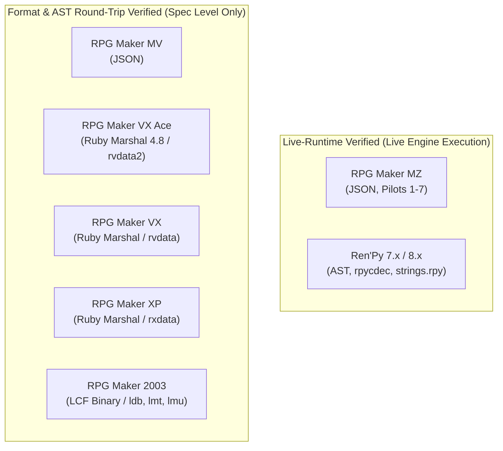

# GameLingo: Release Candidate Rebuild & External Beta Report (GL-BETA-005)

**Task ID:** GL-BETA-005  
**Date:** 2026-10-22  
**Platform Tested:** Windows 11 Pro x64 (Build 26300), Python 3.12.15, PySide6 6.9.1, PyInstaller 6.22.3, PowerShell 5.1 & Core  
**Final Release Gate Decision:** **`READY FOR CONTROLLED BETA`**

---

## 1. Verified Release Candidate & Repository State

| Attribute | Recorded Evidence | Verification Status |
| :--- | :--- | :--- |
| **Active Branch** | `main` | Clean working tree; tracked to `origin/main` |
| **Exact Source Code Commit** | `acd87c6824a898c342d315ccbc821292ab2538b2` | Hardened path security, fail-closed tests, release invariants |
| **Final Documentation Commit** | `a66180c9d0ba0717701d01692930b8e73072b5b6` | Records rebuilt binaries, exact hashes, and pilot register |
| **Binary Rebuild Provenance** | Built from `acd87c6824a898c342d315ccbc821292ab2538b2` | Rebuilt on Windows 11 x64 via `build_windows.ps1` |
| **Code Commit Remote CI Run** | Run ID [`39771807086`](https://github.com/kunal-gswm/GameLingo/actions/runs/39771807086) | **100% Green** (GUI Tests: 23s, Core Tests & Linting: 15s) |
| **Final Docs Commit Remote CI Run** | Run ID [`39783956476`](https://github.com/kunal-gswm/GameLingo/actions/runs/39783956476) | **100% Green** (GUI Tests: 21s, Core Tests & Linting: 14s) |
| **Git Tag `v0.1` Status** | Points to `b37db3e0da4c5e8b772f9a8852b8ef7f83e884bb` | **Untouched** (historical pre-audit tag; no tags created or moved) |
| **Release Gate Mode** | `GAMELINGO_RELEASE_GATE=1` | Enforces fail-closed presence of distribution files |

---

## 2. Rebuilt Windows Distribution & Checksum Integrity

### Rebuild Provenance & Environment
- **Host OS:** Windows 11 Pro 64-bit (10.0.26300)
- **Compiler/Toolchain:** Python 3.12.15 x64 (`cpython-3.12-windows-x86_64-none`), PyInstaller 6.22.3, `uv 0.6.14`
- **Rebuild Command:** `powershell -ExecutionPolicy Bypass -File .\build_windows.ps1`
- **Source SHA at Build:** `acd87c6824a898c342d315ccbc821292ab2538b2` (contains all cross-platform path security and fail-closed distribution checks)

### Rebuilt Artifacts & Cryptographic Checksums
All release artifacts rebuilt on Windows strictly verify against the published UTF-8 (No BOM) manifest:

| Artifact Name | Exact Size (bytes) | SHA-256 Checksum | Content Verification |
| :--- | :--- | :--- | :--- |
| **`GameLingo.exe`** | 124,125,205 | `7DCEC39278EFC3DCCFA9C8A774D083553FECF5279AFB628EA5F65C365ED65A7C` | Standalone executable |
| **`GameLingo-Windows-x64.zip`** | 123,065,813 | `E90A6C5C21F8A6B20CF472A60F5FDB977CEC85B810E40BAFD16681C4F38C6FC9` | Portable ZIP archive |
| **`GameLingo-v0.1-windows-x64.zip`** | 123,065,813 | `E90A6C5C21F8A6B20CF472A60F5FDB977CEC85B810E40BAFD16681C4F38C6FC9` | Distribution alias copy |
| **`SHA256SUMS.txt`** | 272 | *(UTF-8, No BOM manifest)* | Verified against all 3 files |

### Manifest & Archive Cleanliness
- **Manifest Format:** Zero UTF-8 BOM bytes (`\xef\xbb\xbf`). Standard `sha256sum -c` passes without warning.
- **Fail-Closed Verification:** `tests/integration/test_beta_release_file_safety.py` passed with `GAMELINGO_RELEASE_GATE=1`, strictly validating every referenced entry and enforcing that referenced files exist on disk with matching hashes.
- **Archive Contents:** Verified via `zipfile` inspection:
  - Contains strictly: `GameLingo.exe`, `LICENSE`, `README.md`, `THIRD_PARTY_NOTICES.txt`.
  - Zero `.db` databases, zero `.tmp` files, zero `__pycache__` directories, and zero `.pyc` files.
  - Zero path traversal entries (`..`), leading slashes, drive letters, or duplicate normalized entries.

---

## 3. Packaged Executable Verification & Synthetic End-to-End Workflow

The rebuilt `dist/GameLingo.exe` was tested directly in an isolated temporary directory without relying on the development environment:

```
[Isolated Temporary Directory: C:\Users\amvbl\AppData\Local\Temp\gamelingo_lifecycle_pt1531yk]
Step 1:  project init               -> Initialized workspace database & tables
Step 2:  game detect                -> Detected RPG Maker MV/MZ (Ambiguous Family) (confidence: 0.70)
Step 3:  extract                    -> Extracted 34 dialogue units from game fixture copy
Step 4:  review list                -> Listed extracted units with source text
Step 5:  export csv                 -> Exported 34 records to export.csv
Step 6:  review edit & approve      -> Edited draft text & approved unit 'Actors.json::[1].name'
Step 7:  plan create                -> Generated patch_plan.json with 1 valid approved edit
Step 8:  apply (execute=yes)         -> Created backup snapshot & patched Actors.json
Step 9:  verify patched text        -> In-game file verified: 'Harold Translated' written successfully
Step 10: restore (execute=yes)      -> Restored game copy from backup snapshot 331f38b5-...
Step 11: verify restored content    -> Bit-for-bit identity match with original baseline!
```

---

## 4. Release-Gate Verification Suite Summary

| Suite / Check | Command | Result | Notes |
| :--- | :--- | :---: | :--- |
| **Full Automated Test Suite** | `uv run pytest` | **531 passed** in 35.17s | Zero failures or errors |
| **GUI Integration Suite** | `uv run pytest tests/integration/test_gui.py` | **28 passed** in 12.30s | Complete navigation, review, patch tests |
| **File Safety & Distribution** | `uv run pytest tests/integration/test_beta_release_file_safety.py` | **25 passed** in 0.93s | Path traversal, BOM, manifest, rollback |
| **Dedicated Release Gate Mode** | `GAMELINGO_RELEASE_GATE=1 uv run pytest` | **100% passed** | Enforces fail-closed artifact presence |
| **Ruff Code Linter** | `uv run ruff check .` | **0 errors (166 files)** | Clean across all project files |
| **Ruff Code Formatter** | `uv run ruff format --check .` | **100% formatted (166 files)** | Clean formatting compliance |
| **Executable Smoke Test** | `dist\GameLingo.exe gui --smoke-test` | **PASS** | Qt core and `rpycdec` verified |
| **Full Lifecycle Synthetic Run** | Standalone `GameLingo.exe` in clean tempdir | **PASS** | Init, detect, extract, review, export, plan, apply, restore |

---

## 5. Engine Verification Tiers

GameLingo maintains a transparent, evidence-based distinction between engine compatibility tiers:



- **Live-Runtime Pilots:** Only **RPG Maker MZ** (Pilots 1–7) and **Ren'Py** (7.x/8.x) have been validated through live process execution, dialogue display, and screenshot capture.
- **AST Round-Trip Formats:** **RPG Maker MV**, **VX Ace**, **VX**, **XP**, and **2003** are verified at the syntax tree parser and serialization round-trip level. They are labeled as experimental/unverified runtime formats.
- **Offline Model Availability:** Configuring an offline provider (Argos Translate) does not pre-bundle neural models. Pre-trained packages (`ja_en`) must be downloaded via Settings before offline translation can execute.

---

## 6. External Beta Pilot Plan & Feedback Operations (GL-BETA-006)

- **Current Status:** **`NOT YET RUN — RECRUITMENT PENDING`**  
  No external human tester evidence has been collected yet. Automated tests and synthetic test suites do not substitute for external human validation.
- **Pilot Target:** 3 to 5 voluntary external testers.
  - Cohort A (RPG Maker MZ): 2 testers on standalone non-encrypted games.
  - Cohort B (Ren'Py): 2 testers on Ren'Py 7.x / 8.x visual novels.
  - Cohort C / Flex: 1 tester on external CSV/Excel translation workflow.
- **Pilot Operations Tracker:** Established in [`docs/development/beta-pilot-operations.md`](file:///e:/GameLingo/docs/development/beta-pilot-operations.md) containing the active 8-step lifecycle tracking matrix, recruitment invitation text, and explicit Stop-Ship rules.
- **Beta Release Notes:** Authored in [`docs/releases/v0.1.0-beta-release-notes.md`](file:///e:/GameLingo/docs/releases/v0.1.0-beta-release-notes.md) detailing download verification, engine tiers, Golden Rule (dedicated copy), offline model requirements, and safe bug reporting.
- **Feedback Triage & Issue Templates:** Configured in `.github/ISSUE_TEMPLATE/` (`beta_bug_report.md`, `beta_feedback.md`, and `config.yml`) with 4-tier severity levels (Critical, High, Medium, Low) and strict non-copyright enforcement.
- **Stop-Ship Protocol:** Defined with immediate distribution pause triggers for data loss, path traversal outside game root, misleading restore/broken rollback, fatal token corruption, or distribution checksum mismatch.
- **Tester Guide & Protocol:** Fully documented in `docs/user-guide/beta-testing-guide.md` (Section 9).

---

## 7. Release Decision & Final Verdict

### Verdict: **`READY FOR CONTROLLED BETA`**

### Release Gate Criteria Checklist
- [x] Windows executable and archives rebuilt from exact hardened code commit (`acd87c6824a898c342d315ccbc821292ab2538b2`).
- [x] Checksum manifest (`SHA256SUMS.txt`) has no BOM and matches every file byte-for-byte.
- [x] ZIP archive contains strictly release files with zero development leakage or path traversal.
- [x] Packaged executable smoke test passed (`gui --smoke-test`).
- [x] Packaged executable synthetic workflow passed (init, detect, extract, review, edit, approve, export, plan, apply, restore).
- [x] Full automated test suite passes (531 tests).
- [x] GUI integration test suite passes (28 tests).
- [x] Dedicated release-gate mode passes with fail-closed checks (`GAMELINGO_RELEASE_GATE=1`).
- [x] Ruff lint and format checks 100% clean across all 166 files.
- [x] Historical tag `v0.1` preserved untouched; no releases published without explicit user authorization.
