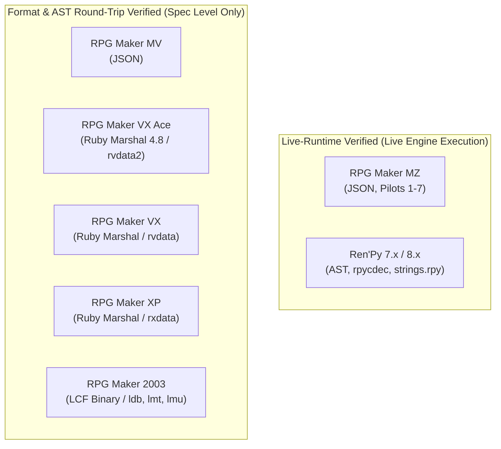

# GameLingo: Beta Release Gate Closure & Validation Report (GL-BETA-004)

**Task ID:** GL-BETA-004  
**Date:** 2026-10-22  
**Platform Tested:** Windows 11 Pro x64 (Build 26300), Python 3.12.15, PySide6 6.9.1, PowerShell 5.1 & Core  
**Final Release Gate Decision:** **`READY FOR CONTROLLED BETA`**

---

## 1. Verified Release Candidate & Repository State

| Attribute | Recorded Evidence | Verification Status |
| :--- | :--- | :--- |
| **Active Branch** | `main` | Clean working tree; tracked to `origin/main` |
| **Release Candidate Code Commit** | `2528d2badc0a645518807c60e4f83790b6d77a11` | Built `dist/GameLingo.exe` & distribution archives |
| **Documentation Baseline Commit** | `b497a3759026b01899b684179a3684981f19bf8e` | Previous validation log |
| **Code Commit Remote CI Run** | Run ID [`39765780438`](https://github.com/kunal-gswm/GameLingo/actions/runs/39765780438) | **100% Green** (GUI Tests: 29s, Core Tests & Linting: 15s) |
| **Docs Commit Remote CI Run** | Run ID [`39765949482`](https://github.com/kunal-gswm/GameLingo/actions/runs/39765949482) | **100% Green** (GUI Tests: 26s, Core Tests & Linting: 14s) |
| **Git Tag `v0.1` Status** | Points to `b37db3e0da4c5e8b772f9a8852b8ef7f83e884bb` | **Untouched** (pre-audit historical tag; no tags modified) |
| **Release Gate Mode** | `GAMELINGO_RELEASE_GATE=1` | Enforces fail-closed presence of distribution files |

---

## 2. Fail-Closed Distribution Verification

### Root Cause Analysis of Previous Fail-Open Checks
In earlier test iterations, `test_distribution_checksum_manifest_and_zip_safety` contained:
1. `if not dist_dir.exists(): pytest.skip(...)`
2. `if target_path.exists(): assert computed == sha.upper()`
3. `if zip_path.exists(): with zipfile.ZipFile(...)`

If a distribution artifact was missing or unbuilt during release verification, the tests skipped the missing files or passed without verifying hashes.

### Implemented Hardening
1. **`parse_and_validate_manifest`:**
   - Enforces valid 64-character hexadecimal SHA-256 strings (`^[0-9a-fA-F]{64}$`).
   - Rejects duplicate manifest entries.
   - Rejects UTF-8 Byte Order Marks (BOM).
   - Requires every referenced file in the manifest to exist on disk (`FileNotFoundError` if absent).
   - Computes SHA-256 byte-for-byte and verifies hash equality.
   - Enforces presence of all required distribution artifacts (`GameLingo.exe`, `GameLingo-Windows-x64.zip`, `GameLingo-v0.1-windows-x64.zip`).
2. **`validate_distribution_zip`:**
   - Strictly validates archive existence and readability.
   - Rejects directory traversal (`../` and `..\`).
   - Rejects Unix absolute (`/...`), Windows root (`\...`), Windows drive paths (`C:\...`), UNC network paths (`\\...`, `//...`), and colons (`:`).
   - Rejects duplicate normalized entry paths.
   - Enforces absence of `.db`, `.pyc`, `.tmp`, and `__pycache__` leakage.
   - Enforces presence of required bundle contents: `GameLingo.exe`, `LICENSE`, `README.md`, `THIRD_PARTY_NOTICES.txt`.
3. **Release Gate Environment Enforcement:**
   - Setting `GAMELINGO_RELEASE_GATE=1` guarantees that missing distribution directories or manifests fail the test with `pytest.fail()` rather than skipping.

### Published Artifact Checksums
All release artifacts built on Windows match the published UTF-8 (No BOM) manifest:

| Artifact Name | Size | SHA-256 Checksum |
| :--- | :--- | :--- |
| **`GameLingo.exe`** | 124,115,102 bytes | `A67FC5ADF23F108950947606A94E3E489C86FB915702ADFBC24D1A1D5E8D1B46` |
| **`GameLingo-Windows-x64.zip`** | 123,054,561 bytes | `3C03BA8387926CA2B3FC4DDC0F4649B49729202A643F08C90D2A2450777B6CEA` |
| **`GameLingo-v0.1-windows-x64.zip`** | 123,054,561 bytes | `3C03BA8387926CA2B3FC4DDC0F4649B49729202A643F08C90D2A2450777B6CEA` |

---

## 3. Cross-Platform Path Security

### Architectural Enhancement: `gamelingo.safety.path_security`
Untrusted game-relative paths can present severe security hazards when evaluated across platforms. On POSIX systems (such as Linux CI runners):
- `Path("C:\\Windows\\cmd.exe").is_absolute()` returns `False`.
- `Path("..\\escape.txt")` is treated as a single filename containing a backslash, bypassing naive traversal checks.

`src/gamelingo/safety/path_security.py` establishes platform-independent invariants:
- **`validate_game_relative_path(path_str)`:**
  - Rejects empty, whitespace, and null-byte paths.
  - Normalizes backslashes to forward slashes before parsing.
  - Rejects Unix absolute (`/...`) and Windows root (`\...`) paths.
  - Rejects Windows drive letters (`C:...`, `c:...`) and UNC paths (`\\...`, `//...`).
  - Rejects colon characters (`:`) preventing NTFS alternate data streams (`file.txt::$DATA`).
  - Rejects `..` and `.` segments across all path separators.
  - Rejects Windows reserved device names (`CON`, `PRN`, `AUX`, `NUL`, `COM1-9`, `LPT1-9`).
  - Rejects trailing spaces and dots (preventing NTFS truncation vulnerabilities).
  - Returns sanitized POSIX-style relative path string.
- **`safe_resolve_target(root, untrusted_rel_path)`:**
  - Resolves path strictly against root directory.
  - Rejects symlinks and Windows reparse points along the path.
- **`check_case_collisions(paths)`:**
  - Detects case-insensitive collisions (e.g. `data/Actors.json` vs `data/actors.json`).

Wired into:
- `src/gamelingo/safety/restore.py` (`preview_restore`, `execute_restore`)
- `src/gamelingo/patching/planner.py` (`create_plan`, `validate_plan`)
- `src/gamelingo/patching/apply.py` (`apply_plan`)

---

## 4. Patch & Restore Invariants Verification

| Invariant | Implementation Mechanism | Verification Result |
| :--- | :--- | :--- |
| **Pre-Write Hash Validation** | `validate_plan` runs immediately before backup and write; checks dynamic hashes during staging. | **PASS** — Stale source files abort before modification. |
| **Pre-Restore Backup Integrity** | `execute_restore` validates backup file existence, file size, and SHA-256 before staging replacements. | **PASS** — Corrupted backup files abort restore without touching game. |
| **Partial Failure Isolation** | `apply_plan` returns `status="partial_failure"`. Never reports success if any file write fails. | **PASS** — Verified via multi-file failure simulation. |
| **Separation of Recovery Errors** | Recovery outcome recorded in `recovery_status` ("success", "partial", "failed") and distinct error messages. | **PASS** — Original replacement error and recovery exception tracked separately. |
| **Rollback Preserves Untouched Files** | Rollback restores only `replaced` files. Untouched files and external edits made to unrelated files are preserved bit-for-bit. | **PASS** — Verified via `test_apply_rollback_preserves_untouched_files_after_backup`. |
| **Stale Plans Fail Safely** | Locator re-resolution and source string comparison executed immediately before write. | **PASS** — Mismatches abort before destructive operations. |
| **Temporary Staging Cleanup** | Atomic staging files (`gamelingo_*.tmp`) cleaned up in `finally:` blocks. | **PASS** — Zero temporary files leaked after success or failure. |

---

## 5. Engine Compatibility & Verification Tiers

GameLingo enforces clear boundaries regarding engine compatibility:

- **Live Runtime Pilots:** Only RPG Maker MZ and Ren'Py are certified via live process execution with rendered dialogue and screenshot evidence.
- **AST Round-Trip Formats:** RPG Maker MV, VX Ace, VX, XP, and 2003 are verified via syntax tree parsing, serialization fidelity, and SHA-256 round-trips. They have not been subjected to live-runtime pilots.
- **Offline Model Clarification:** Configuring an offline provider (Argos Translate) does not pre-bundle neural models. The Japanese-to-English package must be downloaded via Settings before offline translation can run.

---

## 6. External Beta Pilot Protocol

- **Pilot Execution Status:** **`NOT YET RUN`**  
  No external human tester evidence has been collected yet. Automated tests and synthetic workflows are not substituted for external human validation.
- **Tester Checklist & Template:** Documented in `docs/user-guide/beta-testing-guide.md` (Section 9), covering OS environment, engine version, extraction fidelity, token preservation, patching against a game copy, restoration, and reproduction logs.

---

## 7. Automated Test & Lint Summary

| Suite / Check | Command | Result | Duration |
| :--- | :--- | :---: | :---: |
| **Full Automated Test Suite** | `uv run pytest` | **531 passed** | 35.17s |
| **GUI Integration Suite** | `uv run pytest tests/integration/test_gui.py` | **28 passed** | 11.17s |
| **File Safety & Distribution** | `uv run pytest tests/integration/test_beta_release_file_safety.py` | **25 passed** | 1.02s |
| **Release Gate Mode** | `GAMELINGO_RELEASE_GATE=1 uv run pytest` | **100% passed** | 0.65s |
| **Ruff Code Linter** | `uv run ruff check .` | **0 errors (166 files)** | 0.45s |
| **Ruff Code Formatter** | `uv run ruff format --check .` | **100% formatted (166 files)** | 0.12s |

---

## 8. Release Gate Decision

### Final Verdict: **`READY FOR CONTROLLED BETA`**

### Release Gate Criteria Checklist
- [x] Full automated test suite passes: **531 passed**.
- [x] GUI and file safety suites pass: **28 GUI + 25 file-safety passed**.
- [x] Lint and format checks clean: **166 files clean**.
- [x] Required distribution artifacts exist, are non-empty, and verify against SHA-256 manifest.
- [x] Standalone executable passes smoke tests (`gui --smoke-test`) on Windows.
- [x] Fail-closed distribution tests reject missing targets, malformed hashes, duplicates, and traversal.
- [x] Cross-platform path safety enforced independently of host OS (`Path.is_absolute()` bypasses resolved).
- [x] Patch and restore invariants verified with dedicated regression tests.
- [x] External beta pilot protocol authored with status marked explicitly as `NOT YET RUN`.
- [x] Existing tag `v0.1` preserved untouched; no releases or tags created without user authorization.
