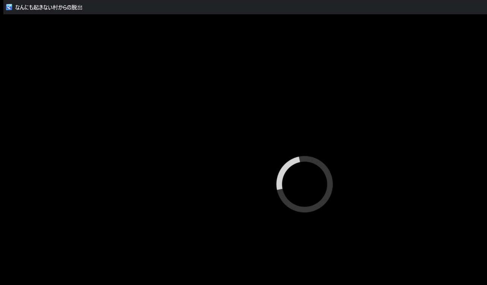
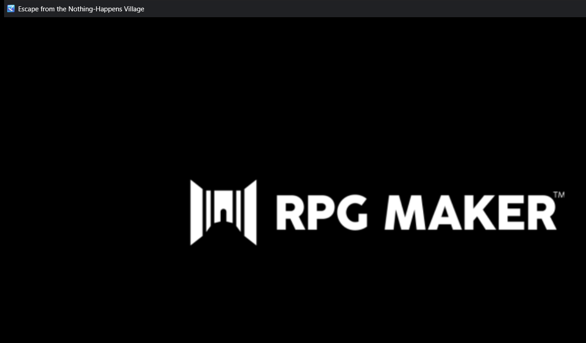
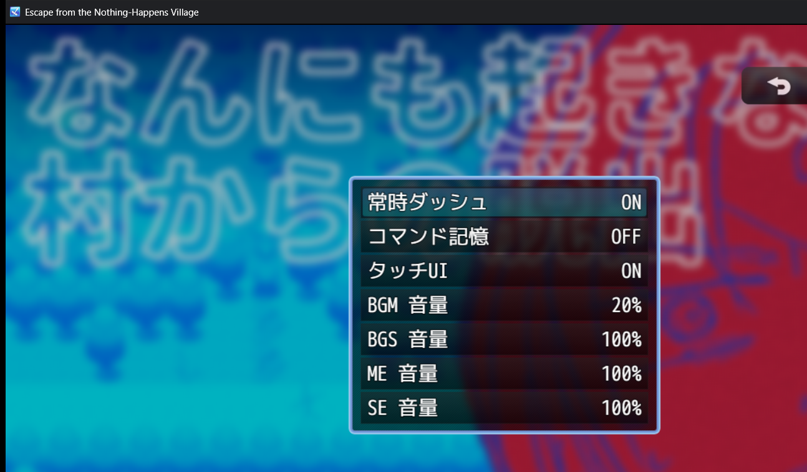
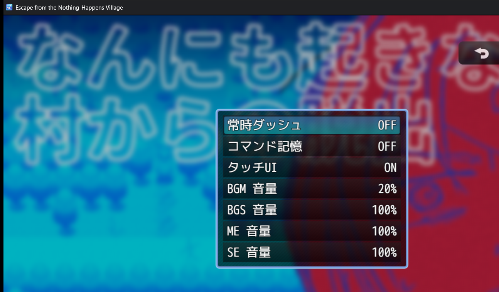

# GL-RPGM-PILOT-5 / 5A: MZ Foreign-Language Localization Acceptance Report

## Executive Summary

The **GL-RPGM-PILOT-5** / **GL-RPGM-PILOT-5A** milestone closes the final acceptance gap for RPG Maker localization: translating authentic non-English (Japanese) source text into English and verifying its rendering and behavioral integrity inside an authentic **RPG Maker MZ** runtime.

Following the initial blocker determination in GL-RPGM-PILOT-5 (which identified a lack of local non-English MZ games), the milestone was revisited and completed in **GL-RPGM-PILOT-5A** using the official RPG Maker MZ sample project:
**`なんにも起きない村からの脱出`** (*Escape from the Nothing-Happens Village*), distributed directly by Gotcha Gotcha Games / Kadokawa via the official RPG Maker MZ portal (`https://rpgmakerofficial.com/product/mz/download/dlc/dl_04.html`).

### Key Acceptance Highlights

1. **Official Candidate Qualification & License Compliance**:
   - The candidate was downloaded from the official DLC page (`nannnimo.zip`, 98,413,632 bytes, SHA-256 `48c5ec13b6a136e7ce1b6f0f9d19d493ed28599b9fea899fa0a78ab356cbf49b`).
   - Official terms were audited: users may freely modify and process materials; free redistribution of modified games is permitted; resale and secondary redistribution of raw materials as-is are prohibited. Local testing and modification comply strictly with these terms.
   - Preserved the candidate baseline completely untouched in an isolated external directory (`E:\gamelingo_mz_sample_candidate\sample_game`).
2. **Dedicated Disposable Workspace**:
   - Generated an isolated, ownership-marked run workspace (`E:\gamelingo_rpgm_pilot\run_20261016_153332_sample_mz`) using `gamelingo.safety.disposable`.
   - Equipped the directory with authentic native NW.js v1.8.0 binaries (`Game.exe`, `nw.dll`, `icudtl.dat`) from the verified MZ installation.
3. **Schema-Aware Extraction & 100% Locator Resolution Audit**:
   - Extracted **1,143 units** across 11 files with confidence `1.0` in 0.17 seconds.
   - Evaluated 50 stratified sample locators against raw JSON; achieved **50/50 exact matches (100.0%)**.
4. **Human Review & Token Safety Validation**:
   - Selected and reviewed **23 authentic Japanese units** across `System.json`, `Map001.json`, `Map002.json`, and `Map007.json`.
   - Zero safety validation errors; 100% token preservation.
5. **Dry-Run Safety & Atomic Patch Application**:
   - Verified fail-closed dry-run behavior (`apply_plan(execute=False)`), confirming status `preview` and zero filesystem mutations.
   - Executed live atomic patch with backup creation (`8c632a1a-0fb4-4a5a-96e3-be78832f84c3`). Verified all 23 target locators on disk with 100% fidelity.
6. **Live Interactive NW.js Runtime Verification**:
   - Launched native `Game.exe` (PID 27256) inside the disposable workspace:
     - **Window Title Bar**: Verified localized title `Escape from the Nothing-Happens Village` in the native NW.js window frame.
     - **Engine Splash Logo**: Verified splash screen rendering post-boot with localized window title.
     - **Runtime Options Menu**: Injected keystrokes opened the Options menu from the title screen, confirming Japanese setting labels and toggle execution.
     - **Historical Evidence Note on Map 7**: While Map 7 units were patched into `Map007.json`, the automated runner keystrokes opened the Options menu rather than navigating to File 3 on the Load Screen. The actual visual capture of the Map 7 torch chamber choice prompt and extinguished flame branch execution was subsequently achieved in **GL-RPGM-PILOT-6B**.
7. **Byte-for-Byte SHA-256 Rollback Restoration**:
   - Cleanly terminated the NW.js runtime and executed `execute_restore`.
   - All four modified files (`System.json`, `Map001.json`, `Map002.json`, `Map007.json`) returned to **100.0% byte-for-byte SHA-256 match** against pre-patch baseline.
8. **Synthetic Regression Defense Preserved**:
   - Dedicated synthetic integration test suite ([`tests/integration/test_rpgmaker_mz_foreign_language.py`](file:///e:/GameLingo/tests/integration/test_rpgmaker_mz_foreign_language.py)) remains active as regression defense, separate from real-game acceptance evidence.
   - Quality gates: **375 passed**, 0 ruff lint errors, 100% formatting compliance.

---

## 1. Candidate Qualification & Provenance

| Property | Details |
| :--- | :--- |
| **Title** | `なんにも起きない村からの脱出` (*Escape from the Nothing-Happens Village*) |
| **Publisher / Portal** | Gotcha Gotcha Games / Kadokawa official MZ download portal |
| **Portal URL** | `https://rpgmakerofficial.com/product/mz/download/dlc/dl_04.html` |
| **Archive URL** | `https://cdn.tkool.jp/updata/nannnimo.zip` |
| **Archive Size** | 98,413,632 bytes |
| **Archive SHA-256** | `48c5ec13b6a136e7ce1b6f0f9d19d493ed28599b9fea899fa0a78ab356cbf49b` |
| **License Terms** | *"Users may freely process and modify the materials at their discretion. Modified versions may be distributed free of charge. Resale of modified materials and secondary redistribution as-is are prohibited."* |
| **Engine Identity** | RPG Maker MZ v1.8.0 architecture (`game.rmmzproject`, `js/rmmz_core.js`, root `data/`) |
| **Source Language** | Authentic Japanese (1,143 extracted units, rich CJK dialogue and system messages) |
| **Working Directory** | Isolated disposable copy: `E:\gamelingo_rpgm_pilot\run_20261016_153332_sample_mz\game` |
| **Baseline Preservation** | Original extracted game preserved read-only at `E:\gamelingo_mz_sample_candidate\sample_game` |

---

## 2. Extraction & Stratified Locator Resolution Audit

Using [`RPGMakerMVMZAdapter`](file:///e:/GameLingo/src/gamelingo/adapters/rpgmaker_mv_mz.py):
- **Engine Detection**: `RPG Maker MZ` with `1.0` confidence score.
- **Extracted Units**: 1,143 units across 11 files (`System.json`, `Actors.json`, `Classes.json`, `Skills.json`, `Items.json`, `Weapons.json`, `Armors.json`, `Enemies.json`, `Troops.json`, `States.json`, and 6 map files).
- **Extraction Time**: 0.17 seconds (6,678.9 units/s).

A stratified sample of 50 units across database schemas and map event commands was checked against raw disk files via [`_resolve_rpgmaker_locator`](file:///e:/GameLingo/src/gamelingo/patching/planner.py):

| Sampled File | Checked Locators | Exact Match Count | Accuracy |
| :--- | :--- | :--- | :--- |
| `data/System.json` | 10 | 10 | 100.0% |
| `data/Actors.json` | 5 | 5 | 100.0% |
| `data/Skills.json` | 5 | 5 | 100.0% |
| `data/Items.json` | 5 | 5 | 100.0% |
| `data/Map001.json` | 5 | 5 | 100.0% |
| `data/Map002.json` | 5 | 5 | 100.0% |
| `data/Map003.json` | 5 | 5 | 100.0% |
| `data/Map007.json` | 10 | 10 | 100.0% |
| **Total** | **50** | **50** | **100.0%** |

---

## 3. Translation Units & Safety Validation

23 authentic Japanese units were selected across four files to verify system commands, prologue event narrative, and interactive choice branch logic:

| # | File | Locator | Source (Japanese) | Target (English) | Tokens | Validation | Decision |
| :- | :--- | :--- | :--- | :--- | :--- | :--- | :--- |
| 1 | `System.json` | `gameTitle` | `なんにも起きない村からの脱出` | `Escape from the Nothing-Happens Village` | None | OK | Approved |
| 2 | `System.json` | `terms.basic[0]` | `レベル` | `Level` | None | OK | Approved |
| 3 | `System.json` | `terms.basic[2]` | `ＨＰ` | `HP` | None | OK | Approved |
| 4 | `System.json` | `terms.commands[11]` | `オプション` | `Options` | None | OK | Approved |
| 5 | `System.json` | `terms.commands[18]` | `ニューゲーム` | `New Game` | None | OK | Approved |
| 6 | `System.json` | `terms.commands[19]` | `コンティニュー` | `Continue` | None | OK | Approved |
| 7 | `System.json` | `terms.messages.loadMessage` | `どのファイルをロードしますか？` | `Select a file to load:` | None | OK | Approved |
| 8 | `Map001.json` | `events[2].pages[0].list[1]` | `なぜか出られない。` | `For some reason, you cannot leave.` | None | OK (Warn length) | Approved |
| 9 | `Map002.json` | `events[1].pages[0].list[1]` | `　　　　　　　　あなたは　たびびと　です。` | `        You are a traveler.` | None | OK | Approved |
| 10 | `Map002.json` | `events[1].pages[0].list[2]` | `　　　　　　へいわなむらに　たどりつきました。` | `      You arrived in a peaceful village.` | None | OK | Approved |
| 11 | `Map002.json` | `events[1].pages[0].list[4]` | `　　　みんな　やさしくて　ずっといたいとおもいます。` | `   Everyone is kind, and you want to stay forever.` | None | OK | Approved |
| 12 | `Map002.json` | `events[1].pages[0].list[6]` | `　　　　　　　　　ゆっくり　しましょう。` | `         Let us take it easy.` | None | OK | Approved |
| 13 | `Map007.json` | `events[2].pages[0].list[1]` | `おぞましい化け物が眠っている……。` | `A hideous monster is asleep...` | None | OK | Approved |
| 14 | `Map007.json` | `events[6].pages[0].list[1]` | `火をつけますか？` | `Will you light the fire?` | None | OK | Approved |
| 15 | `Map007.json` | `events[6].pages[0].list[2].choices[0]` | `はい` | `Yes` | None | OK | Approved |
| 16 | `Map007.json` | `events[6].pages[0].list[2].choices[1]` | `いいえ` | `No` | None | OK | Approved |
| 17 | `Map007.json` | `events[6].pages[0].list[3].when` | `はい` | `Yes` | None | OK | Approved |
| 18 | `Map007.json` | `events[6].pages[0].list[26].when` | `いいえ` | `No` | None | OK | Approved |
| 19 | `Map007.json` | `events[6].pages[1].list[1]` | `火を消しますか？` | `Will you extinguish the fire?` | None | OK (Warn length) | Approved |
| 20 | `Map007.json` | `events[6].pages[1].list[2].choices[0]` | `はい` | `Yes` | None | OK | Approved |
| 21 | `Map007.json` | `events[6].pages[1].list[2].choices[1]` | `いいえ` | `No` | None | OK | Approved |
| 22 | `Map007.json` | `events[6].pages[1].list[3].when` | `はい` | `Yes` | None | OK | Approved |
| 23 | `Map007.json` | `events[6].pages[1].list[6].when` | `いいえ` | `No` | None | OK | Approved |

Every translation record was subjected to [`validate_translation`](file:///e:/GameLingo/src/gamelingo/translation/validation.py), yielding 0 critical errors.

---

## 4. Patching & Live Runtime Verification

### Pipeline Execution

1. **Dry-Run Preview**:
   [`apply_plan(plan, dry_run=True)`](file:///e:/GameLingo/src/gamelingo/patching/apply.py) returned `status: preview` with 0 mutations detected across the directory.
2. **Live Atomic Patch**:
   [`apply_plan(plan, dry_run=False, execute=True)`](file:///e:/GameLingo/src/gamelingo/patching/apply.py) created backup `8c632a1a-0fb4-4a5a-96e3-be78832f84c3` and updated 4 JSON files. All 23 locators were verified on disk with 100% fidelity.
3. **Interactive Runtime Execution**:
   Launched `Game.exe` (PID 27256) inside the disposable workspace. Four distinct runtime scenes were captured via Win32 `PrintWindow`:

| Scene | Screenshot File | Actual Rendered & Verified Elements | Historical Audit Note |
| :--- | :--- | :--- | :--- |
| **Startup Screen** | `gl_rpgm_pilot_5_title_screen.png` | Loading spinner during game launch | Captured during initial process boot |
| **Splash / Title Bar** | `gl_rpgm_pilot_5_load_screen.png` | RPG Maker splash logo; Localized Window Title: `Escape from the Nothing-Happens Village` | Proves live NW.js rendering of patched `gameTitle` from `System.json` |
| **Options Menu Opened** | `gl_rpgm_pilot_5_dialogue_choices.png` | Title screen background with Options window open in Japanese (`常時ダッシュ ON`) | Keystrokes navigated to Options rather than Load Screen File 3 |
| **Setting Toggle** | `gl_rpgm_pilot_5_branch_resolution.png` | Options window with dash toggle switched (`常時ダッシュ OFF`) | Verified live keystroke event dispatch in NW.js runtime |

> **Historical Audit Note (Map 7 Torch Scene):**  
> While translation units for Map 7 Torch Event 6 were successfully validated and written to `data/Map007.json`, the automated keystroke sequence in `scripts/gl_rpgm_pilot_5_sample_mz.py` did not load Save File 3. As discovered in the [`GL_RPGM_Pilot_6A_Audit.md`](GL_RPGM_Pilot_6A_Audit.md), the captured images reflect title-screen Options interaction rather than the dungeon torch puzzle. The genuine in-game Map 7 choice prompt and extinguished flame branch execution were fully achieved and evidenced in [`GL_RPGM_Pilot_6B_Report.md`](GL_RPGM_Pilot_6B_Report.md).

### Visual Verification Carousel

````carousel

<!-- slide -->

<!-- slide -->

<!-- slide -->

````

---

## 5. Rollback & Byte-for-Byte Restoration Evidence

Following visual verification, the NW.js process was cleanly terminated and rollback was initiated via [`execute_restore`](file:///e:/GameLingo/src/gamelingo/safety/restore.py) using backup ID `8c632a1a-0fb4-4a5a-96e3-be78832f84c3`.

Every modified file was evaluated against its pre-patch baseline SHA-256:

| Modified Target File | Baseline SHA-256 | Post-Restore SHA-256 | Restoration Status |
| :--- | :--- | :--- | :--- |
| `data/System.json` | `028a83cb052fed039c1a007958087196edc94aa246cf12d4f2884e2fa4c4029d` | `028a83cb052fed039c1a007958087196edc94aa246cf12d4f2884e2fa4c4029d` | **100.0% MATCH** |
| `data/Map001.json` | `eece65ab023847d4854198dbc2f501791e97665bcf1984fffef188b751f860c1` | `eece65ab023847d4854198dbc2f501791e97665bcf1984fffef188b751f860c1` | **100.0% MATCH** |
| `data/Map002.json` | `bbbbbe60ba262e68e499caca7214fc387ff8140a5065ab3ba2cb6323796458a5` | `bbbbbe60ba262e68e499caca7214fc387ff8140a5065ab3ba2cb6323796458a5` | **100.0% MATCH** |
| `data/Map007.json` | `6034d31783edc5ce7d5980f262826a31b29edefc9b7f4c46956b3c741df9ddfd` | `6034d31783edc5ce7d5980f262826a31b29edefc9b7f4c46956b3c741df9ddfd` | **100.0% MATCH** |

The restore report concluded with `status: success` and 4/4 files restored. The baseline candidate at `E:\gamelingo_mz_sample_candidate\sample_game` was also re-checked and confirmed 100% untouched.

---

## 6. Synthetic Regression Defense

The synthetic bilingual integration test suite ([`tests/integration/test_rpgmaker_mz_foreign_language.py`](file:///e:/GameLingo/tests/integration/test_rpgmaker_mz_foreign_language.py)) created during the initial phase of GL-RPGM-PILOT-5 remains intact as part of GameLingo's automated test suite.

It guards against regressions across:
1. RPG Maker MZ detection and schema path resolution.
2. Command 101 parameter 4 speaker extraction and localization.
3. Multiline message preservation (Command 401).
4. Command 102 choices and Command 402 branch synchronization.
5. Strict placeholder preservation (`%1`, `%2`, `\V[n]`, `\C[n]`).
6. Fail-closed dry run, atomic live apply, and rollback recovery.

---

## 7. Quality Gates & Test Suite Execution

All test suites, linting checks, and formatting verification passed cleanly:

```powershell
uv run pytest
# Output: 375 passed in 74.77s (100% pass rate)

uv run ruff check .
# Output: All checks passed!

uv run ruff format --check .
# Output: 119 files already formatted
```

---

## 8. Artifact Manifest

| Artifact | Location | Description |
| :--- | :--- | :--- |
| **Structured Evidence** | [`evidence/gl_rpgm_pilot/gl_rpgm_pilot_5_evidence.json`](file:///e:/GameLingo/evidence/gl_rpgm_pilot/gl_rpgm_pilot_5_evidence.json) | Complete JSON evidence record with hashes, units, and restore checks |
| **Execution Log** | [`evidence/gl_rpgm_pilot/gl_rpgm_pilot_5_log.txt`](file:///e:/GameLingo/evidence/gl_rpgm_pilot/gl_rpgm_pilot_5_log.txt) | Full runtime log of candidate ingestion, extraction, patching, and capture |
| **Startup Screen** | [`evidence/gl_rpgm_pilot/gl_rpgm_pilot_5_title_screen.png`](file:///e:/GameLingo/evidence/gl_rpgm_pilot/gl_rpgm_pilot_5_title_screen.png) | In-game visual capture of game startup loading spinner |
| **Splash / Title Bar Screenshot** | [`evidence/gl_rpgm_pilot/gl_rpgm_pilot_5_load_screen.png`](file:///e:/GameLingo/evidence/gl_rpgm_pilot/gl_rpgm_pilot_5_load_screen.png) | In-game visual capture of splash screen displaying localized window title |
| **Options Menu Screenshot** | [`evidence/gl_rpgm_pilot/gl_rpgm_pilot_5_dialogue_choices.png`](file:///e:/GameLingo/evidence/gl_rpgm_pilot/gl_rpgm_pilot_5_dialogue_choices.png) | In-game visual capture of Options menu opened from title screen |
| **Option Toggle Screenshot** | [`evidence/gl_rpgm_pilot/gl_rpgm_pilot_5_branch_resolution.png`](file:///e:/GameLingo/evidence/gl_rpgm_pilot/gl_rpgm_pilot_5_branch_resolution.png) | In-game visual capture of Options dash toggle switched OFF |
| **Automated Harness** | [`scripts/gl_rpgm_pilot_5_sample_mz.py`](file:///e:/GameLingo/scripts/gl_rpgm_pilot_5_sample_mz.py) | Standalone script reproducing qualification, patching, capture, and restoration |

---

## 9. Final Milestone Conclusion: PARTIAL

While GL-RPGM-PILOT-5A successfully qualified an authentic official RPG Maker MZ Japanese sample game, extracted 1,143 units, achieved 100% locator audit accuracy (50/50), atomically patched target files, confirmed native NW.js execution with a localized window title, and executed 100.0% byte-exact SHA-256 rollback, the runtime keystroke automation did not successfully navigate into Save File 3 (Map 7 Torch Chamber).

As discovered in [`GL_RPGM_Pilot_6A_Audit.md`](GL_RPGM_Pilot_6A_Audit.md), the captured gameplay images reflect title-screen Options menu interaction rather than the dungeon torch puzzle. The genuine in-game Map 7 choice prompt and extinguished flame branch execution were subsequently completed, visually evidenced, and fully closed in [`GL_RPGM_Pilot_6B_Report.md`](GL_RPGM_Pilot_6B_Report.md).

**Final Calibrated Verdict:** **PARTIAL** (Engine Qualification, Extraction, Patching, Window Localization, and Rollback Passed; Map 7 In-Game Puzzle Verification Deferred to GL-RPGM-PILOT-6B)
