# GL-RPGM-PILOT-5: MZ Foreign-Language Localization Acceptance Report

## Executive Summary

The **GL-RPGM-PILOT-5** milestone investigates the final acceptance gap for RPG Maker localization: translating genuine non-English (specifically Japanese) source text into English and verifying its rendering and behavioral integrity inside an authentic **RPG Maker MZ** runtime.

Following exhaustive inspection of all local game repositories, an authoritative blocker determination was established:
1. **Absence of Local Non-English MZ Projects**: All locally available RPG Maker MZ titles (*Playful Parcels* and *Waifu Trap House*) are native English-source titles (0 CJK characters). All locally available Japanese RPG Maker titles (*Do Disciplinary Committee Members Dream of Succubi* and *RJ01731048*) run on the RPG Maker **MV** v1.6.1 runtime and schema.
2. **Strict Compliance with Milestone Mandates**: In accordance with user constraints:
   - No external commercial games were downloaded.
   - English text with diagnostic suffixes was strictly rejected as a substitute for translation.
   - Synthetic fixtures are explicitly distinguished and not misrepresented as real-game acceptance results.
   - The milestone status is calibrated as **BLOCKED** on real-game native runtime acceptance due to asset unavailability.
3. **Synthetic Bilingual MZ Regression Suite**: To defend against regressions, a comprehensive synthetic bilingual RPG Maker MZ test suite was developed ([`tests/integration/test_rpgmaker_mz_foreign_language.py`](file:///e:/GameLingo/tests/integration/test_rpgmaker_mz_foreign_language.py)). It proves that GameLingo's adapter, translation record models, token safety validator, patch planner, fail-closed dry-run, live atomic patcher, and rollback engine successfully handle genuine Japanese text, MZ-specific Command 101 speaker parameters, multiline text, choices, choice branches, escape codes (`\C[n]`, `\V[n]`), and variable placeholders (`%1`, `%2`).
4. **Clean Quality Gates**: Full test suite passes completely (**375 passed**), with zero linter errors and 100% code formatting compliance.

---

## 1. Objective & Milestone Calibration

| Requirement | Specification | Result / Finding |
| :--- | :--- | :--- |
| **Language Direction** | Non-English (Japanese) -> English | Verified in synthetic MZ regression; **BLOCKED** for real-game MZ runtime |
| **Target Engine** | RPG Maker MZ | v1.8.0 architecture verified; no foreign-language MZ game found locally |
| **Speaker Extraction** | MZ Command 101 parameter 4 | Verified in adapter and synthetic MZ suite; extracted and translated |
| **Choice Branches** | Command 102 & Command 402 synchronization | Verified in synthetic MZ suite; choice array and branch `when` patched |
| **Safety Validation** | Strict token & placeholder enforcement | `%1`, `%2`, `\V[5]`, `\C[2]` verified; missing tokens trigger fail-closed errors |
| **Patch & Rollback** | Atomic replacement + 100% SHA-256 restoration | 100.0% SHA-256 match verified across all modified files |
| **Milestone Status** | Calibrated verdict per prompt Section 7 | **BLOCKED** (Real-Game Native Runtime Foreign-Language Acceptance) |

---

## 2. Local Candidate Game Audit & Blocker Determination

A comprehensive inspection of all candidate game and media directories across `C:\`, `D:\`, and `E:\` was conducted to find legally available RPG Maker MZ titles containing authentic foreign-language text:

| Path / Archive | Engine | Runtime Version | Source Language | Qualification & Assessment |
| :--- | :--- | :--- | :--- | :--- |
| `D:\New folder\Playful Parcels` | RPG Maker MZ | v1.8.0 (`js/rmmz_core.js`) | English (0 CJK chars) | Qualified & accepted in [GL-RPGM-PILOT-4](file:///e:/GameLingo/docs/releases/GL_RPGM_Pilot_4_Report.md) for MZ architecture and patching. **Ineligible** for foreign-language translation. |
| `D:\New folder\Waifu Trap House` | RPG Maker MZ | v1.8.0 (`js/rmmz_core.js`) | English (0 CJK chars) | Root `data/` schema, but entirely English source. **Ineligible**. |
| `D:\New folder\[RYuugames] RY-4233960_V1.04\...` | RPG Maker MV | v1.6.1 (`www/js/rpg_core.js`) | Japanese (138,491 CJK chars) | Validated in [GL-RPGM-PILOT-3](file:///e:/GameLingo/docs/releases/GL_RPGM_Pilot_3_Report.md) / [GL-RPGM-PILOT-3A](file:///e:/GameLingo/docs/releases/GL_RPGM_Pilot_3A_Evidence_Audit.md). **Ineligible** for MZ acceptance (runs on MV schema and `rpg_*.js`). |
| `D:\New folder\[Ryuugames] RY-RJ01731048.rar` | RPG Maker MV | v1.6.1 (`rpg_core.js`) | Japanese | Packed archive containing MV layout (`data/www/js/rpg_core.js`), not MZ. **Ineligible**. |
| `D:\New folder\[Ryuugames] RY-RJ01422252_RJ01497775_EN\...` | KiriKiri | `.xp3` archives | Japanese / English | Visual novel engine (`野良猫少女との生活.eXe`), not RPG Maker. **Ineligible**. |
| `D:\New folder\どこでもHな世界～地味子のバイト日記～` | Custom NW.js | Custom `orzi` framework | Japanese | HTML5 web wrapper with custom scripts, not RPG Maker. **Ineligible**. |
| `D:\SteamLibrary\steamapps\common\*` | Various | Unreal / Custom / Clausewitz | Various | Non-RPG Maker titles (Call of Duty, Euro Truck, Hearts of Iron IV, Wuthering Waves). **Ineligible**. |
| `D:\Games\*` | Various | Clausewitz / RAGE | Various | Non-RPG Maker titles (Crusader Kings 3, GTA V). **Ineligible**. |

### Authoritative Blocker Finding

No authentic foreign-language RPG Maker MZ game exists locally on the developer machine. In accordance with Section 2 of the milestone specification:
> *"If no suitable project is available, stop and report the blocker. A synthetic bilingual fixture may be used for adapter regression testing, but it must not be represented as a real foreign-language game acceptance result."*

Work on live runtime gameplay capture for this milestone was cleanly halted to avoid fabricating evidence or substituting English text with diagnostic suffixes.

---

## 3. Prior Validated Capabilities Reference

The two halves of the RPG Maker localization requirement have both been proven independently in authentic commercial titles:

```mermaid
flowchart TD
    subgraph MV_Validated["GL-RPGM-PILOT-3 / 3A (MV Japanese Acceptance)"]
        A1["Game: Do Disciplinary Committee Members..."] --> A2["Genuine Japanese Text (138k CJK chars)"]
        A2 --> A3["Reviewed English Targets (18 Units)"]
        A3 --> A4["Native NW.js Runtime Dialogue & Choices Rendered"]
        A4 --> A5["Byte-for-Byte SHA-256 Rollback Match"]
    end

    subgraph MZ_Validated["GL-RPGM-PILOT-4 (MZ Engine Acceptance)"]
        B1["Game: Playful Parcels (MZ v1.8.0)"] --> B2["Root data/ & 3D Particle Architecture"]
        B2 --> B3["Command 101 Speaker Extraction (2,768 Units)"]
        B3 --> B4["Native NW.js Runtime Gameplay (4 Scenes)"]
        B4 --> B5["Byte-for-Byte SHA-256 Rollback Match"]
    end

    subgraph PILOT_5["GL-RPGM-PILOT-5 Status"]
        C1["MZ + Foreign Language Runtime Acceptance"]
        C1 -.->|BLOCKED: No Local Japanese MZ Game| C2["Requires Japanese MZ Game Ingestion"]
        C1 -->|VERIFIED| C3["Synthetic Bilingual MZ Regression Test Suite"]
    end
```



1. **Japanese Dialogue, Choices & Formatting**: Proven in [GL-RPGM-PILOT-3](file:///e:/GameLingo/docs/releases/GL_RPGM_Pilot_3_Report.md) against RPG Maker MV (dialogue rendering, choice navigation, branch resolution, `\C[2]` color formatting, `\N[1]` variable substitution).
2. **MZ Engine, Speaker Extraction & Patching**: Proven in [GL-RPGM-PILOT-4](file:///e:/GameLingo/docs/releases/GL_RPGM_Pilot_4_Report.md) against RPG Maker MZ (root `data/` schema, `.rmmzsave` compression, Command 101 parameter 4 speaker extraction, NW.js runtime execution, byte-exact rollback).

---

## 4. Synthetic Bilingual MZ Regression Verification

To prevent regressions and verify that GameLingo's core pipeline properly handles genuine Japanese source text within the RPG Maker MZ data schema, a dedicated integration test suite was created in [`tests/integration/test_rpgmaker_mz_foreign_language.py`](file:///e:/GameLingo/tests/integration/test_rpgmaker_mz_foreign_language.py).

### Fixture Specifications

- **Directory Layout**: Root `data/`, `js/rmmz_core.js`, and `effects/` 3D particle assets.
- **Source Language**: Genuine Japanese source text across database and map files:
  - `System.json`: Title `"妖精の小包"` (*Fairy Parcels*), currency `"ゴールド"`, commands, basic terms (`"レベル"`, `"Lv"`), and messages (`"どのファイルをロードしますか？"`, `"%1 は %2 の ダメージを うけた！"`).
  - `Actors.json`: Character names and profiles (`"ヒナタ"`, `"配達見習い"`, `"元気いっぱいの見習い配達員。"`).
  - `Skills.json`: Combat skills with escape codes and placeholders (`"全力疾走"`, `"素早く荷物を届ける。\\C[2]俊敏性上昇\\C[0]。"`, `"%1は全力で駆け出した！"`).
  - `Items.json`: Items with variable placeholders and literal square brackets (`"特製スタミナ茶"`, `"MPを \\V[5] 回復する [常備薬]。"`).
  - `Map001.json`: Map name `"物流配送センター"`, Event 1 with MZ-specific **Command 101 parameter 4 speaker name** (`"タカヤマ店長"`), multiline dialogue (Command 401), choice array (Command 102: `["すぐに配達する", "荷物を確認する", "後回しにする"]`), and branch handlers (Command 402 `when`).

### Tested Pipeline Stages

| Pipeline Stage | Function / Module | Test Assertion | Result |
| :--- | :--- | :--- | :--- |
| **Engine Detection** | [`RPGMakerMVMZAdapter.detect`](file:///e:/GameLingo/src/gamelingo/adapters/rpgmaker_mv_mz.py#L38-L90) | Returns `("RPG Maker MZ", 1.0)` and maps root `data/` paths | **PASS** |
| **Extraction & Speaker** | [`RPGMakerMVMZAdapter.extract`](file:///e:/GameLingo/src/gamelingo/adapters/rpgmaker_mv_mz.py#L94-L101) | Extracts 63 Japanese units; parses Command 101 parameter 4 as speaker `"タカヤマ店長"` | **PASS** |
| **Locator Resolution** | [`_resolve_rpgmaker_locator`](file:///e:/GameLingo/src/gamelingo/patching/planner.py#L29-L64) | Evaluates all 63 locators on raw JSON; 100% exact match to source text | **PASS** |
| **Token Safety** | [`validate_translation`](file:///e:/GameLingo/src/gamelingo/translation/validation.py) | Confirms `%1`, `%2`, `\\V[5]`, `\\C[2]` preserved; missing tokens trigger fail-closed errors | **PASS** |
| **Patch Planning** | [`create_plan`](file:///e:/GameLingo/src/gamelingo/patching/planner.py#L66-L440) | Plans 26 valid edits across 5 files; rejects unapproved or missing translations | **PASS** |
| **Dry-Run Safety** | [`apply_plan(execute=False)`](file:///e:/GameLingo/src/gamelingo/patching/apply.py#L82-L115) | Returns `status: preview`; verifies zero filesystem mutations | **PASS** |
| **Live Atomic Patching** | [`apply_plan(execute=True)`](file:///e:/GameLingo/src/gamelingo/patching/apply.py#L82-L460) | Creates backup; updates speaker, choices, branches, and database terms; valid JSON | **PASS** |
| **Byte-Exact Rollback** | [`execute_restore`](file:///e:/GameLingo/src/gamelingo/safety/restore.py#L134-L338) | Restores 5/5 files; verifies 100.0% byte-for-byte SHA-256 match to pre-patch baseline | **PASS** |

### Verified Representative Japanese Units

| File | Locator | Source (Japanese) | Target (English) | Special Handling |
| :--- | :--- | :--- | :--- | :--- |
| `Map001.json` | `events[1].pages[0].list[0].speaker` | `タカヤマ店長` | `Store Manager Takayama` | MZ Command 101 parameter 4 speaker |
| `Map001.json` | `events[1].pages[0].list[1]` | `本日の特急配送依頼を確認してください。` | `Please check today's express delivery request.` | Multiline dialogue line 1 |
| `Map001.json` | `events[1].pages[0].list[2]` | `準備は整いましたか？` | `Are you fully prepared?` | Multiline dialogue line 2 |
| `Map001.json` | `events[1].pages[0].list[3].choices[0]` | `すぐに配達する` | `Deliver immediately` | Command 102 choice 0 |
| `Map001.json` | `events[1].pages[0].list[4].when` | `すぐに配達する` | `Deliver immediately` | Command 402 branch condition 0 |
| `Map001.json` | `events[1].pages[0].list[5]` | `素晴らしい！安全第一で行ってきなさい。` | `Splendid! Put safety first and be on your way.` | Choice 0 branch response |
| `Skills.json` | `[1].message1` | `%1は全力で駆け出した！` | `%1 dashed forward at full speed!` | Protected placeholder `%1` |
| `Items.json` | `[1].description` | `MPを \\V[5] 回復する [常備薬]。` | `Restores \\V[5] MP [Household Medicine].` | Escape code `\\V[5]` & literal brackets |
| `System.json` | `terms.messages.loadMessage` | `どのファイルをロードしますか？` | `Select a save file to load.` | System UI message |

---

## 5. Quality Gates & Test Suite Execution

All test suites and code hygiene linters were executed to completion:

```powershell
uv run pytest
# Output: 375 passed in 26.91s (100% pass rate)

uv run ruff check .
# Output: All checks passed!

uv run ruff format --check .
# Output: 117 files already formatted
```

- **Default Test Suite Result**: **375 passed** (compared to 371 passed in GL-RPGM-PILOT-4, adding 4 new exhaustive integration tests for Japanese MZ localization).
- **Ruff Linter**: Zero warnings, zero errors.
- **Ruff Formatter**: 100% compliant.

---

## 6. Milestone Conclusion & Unblocking Path

### Final Verdict: BLOCKED

In accordance with prompt instructions:
> *"Use PASS only when genuine non-English MZ text is translated, reviewed, visibly rendered, and behaviorally verified in the native runtime with successful restoration. Otherwise use PARTIAL or BLOCKED, stating the exact reason."*

- **Exact Reason for BLOCKED Status**: No unpacked or playable Japanese (or non-English) RPG Maker MZ game exists on the local workstation. GameLingo refuses to fabricate screenshots, simulate native acceptance with synthetic fixtures, or use English source games with diagnostic suffixes.
- **Current State of Evidence**:
  1. Japanese-to-English native NW.js gameplay acceptance: **PASSED** on RPG Maker MV ([GL-RPGM-PILOT-3](file:///e:/GameLingo/docs/releases/GL_RPGM_Pilot_3_Report.md)).
  2. RPG Maker MZ native NW.js gameplay acceptance: **PASSED** on RPG Maker MZ architecture ([GL-RPGM-PILOT-4](file:///e:/GameLingo/docs/releases/GL_RPGM_Pilot_4_Report.md)).
  3. Japanese MZ adapter, extraction, speaker parsing, choice planning, and rollback: **VERIFIED** via regression test suite ([`tests/integration/test_rpgmaker_mz_foreign_language.py`](file:///e:/GameLingo/tests/integration/test_rpgmaker_mz_foreign_language.py)).
- **Unblocking Criteria**: To upgrade this milestone from **BLOCKED** to **PASSED**, provide a licensed, unpacked Japanese RPG Maker MZ title in a known local directory. Once provided, the automated capture runner (`scripts/gl_rpgm_pilot_4_mz.py` pattern) can be immediately applied to record native in-game screenshots and choice interactions.
