# GL-RPGM-PILOT-7A: Historical Evidence Reconciliation & Production-Readiness Claim Audit

**Milestone:** GL-RPGM-PILOT-7A  
**Date:** October 16, 2026  
**Status:** **AUDIT COMPLETED & RECONCILED**  
**Repository:** `https://github.com/kunal-gswm/GameLingo`  
**Published Commit:** `05d6d769dab71c1ab5b5fc03e2ce095f4468c4e5`  
**Quality Gates:** 378 passing tests (`uv run pytest`), 0 lint errors (`uv run ruff check .`), 100% format compliance (`uv run ruff format --check .`)  

---

## 1. Executive Summary & Objective

The objective of **GL-RPGM-PILOT-7A** is to audit, reconcile, and correct published reports, milestone history records, and capability matrices across RPG Maker milestones **GL-RPGM-PILOT-5/5A**, **6**, **6A**, **6B**, and **7**.

### Purpose of this Reconciliation
In recent pilot reports, several historical claims regarding in-game interactive scenes and application layer boundaries conflicted with actual evidentiary artifacts:
1. **Scene Misattributions in Pilot 5A and Pilot 6:** Reports for Pilot 5A and Pilot 6 claimed live in-game verification of the Map 7 dungeon torch puzzle (`Map007.json` Event 6). However, the independent audit in Pilot 6A revealed that due to keystroke navigation timing differences in NW.js, the captured screenshots actually showed the Title Options menu (in Pilot 5A) and the Load Screen list / Map 2 prologue (in Pilot 6). The authentic Map 7 torch chamber interaction and extinguished flame branch execution were first achieved and visually proven in **GL-RPGM-PILOT-6B**.
2. **Execution Boundary Clarification:** The Pilot 6 report initially claimed all nine stages passed through the full application workflow; however, Pilot 6A demonstrated that stages 3, 4, 5, 6 (apply), and 9 were driven through direct domain service method invocations rather than GUI widget event dispatches. 100% GUI widget automation was subsequently established in **GL-RPGM-PILOT-6B**.
3. **Verification Tier Calibration:** The Pilot 7 coverage matrix labelled all database files (`Actors.json`, `Classes.json`, etc.) as "Tier 1, Live Game," which conflated extraction and patch verification on authentic commercial game files with direct in-game visual rendering in an active game window.
4. **Repository Hygiene:** Several report files contained machine-specific absolute file URIs (`file:///C:/Users/...`) in markdown image links rather than clean, portable repository-relative paths.

This audit eliminates all demonstrably false or contradictory claims, calibrates all verification tiers, verifies zero proprietary asset leakage, and confirms that GameLingo's implementation is sound, robust, and verified.

---

## 2. Claim-by-Claim Evidence Reconciliation

```mermaid
flowchart TD
    subgraph Pilot5["Pilot 5 / 5A"]
        P5_Claim["Claim: Map 7 Torch Scene Extinguished"]
        P5_Actual["Actual: Options Menu Interaction<br>(常時ダッシュ ON -> OFF)"]
        P5_Calib["Calibrated Status: PARTIAL<br>(Extraction, Patching, Window Title OK;<br>Torch Scene Deferred)"]
        P5_Claim -.-> P5_Actual --> P5_Calib
    end

    subgraph Pilot6["Pilot 6 & 6A"]
        P6_Claim["Claim: 9-Stage GUI Drive & Map 7 Torch Scene"]
        P6A_Audit["Audit (6A): Stages 3,4,5,6,9 called Services;<br>Screenshots captured Load List / Prologue"]
        P6_Calib["Calibrated Status: PARTIAL<br>(App Architecture & Services OK;<br>GUI Widgets & Torch Scene Deferred)"]
        P6_Claim -.-> P6A_Audit --> P6_Calib
    end

    subgraph Pilot6B["Pilot 6B (Evidence Closure)"]
        P6B_Save["Decompressed .rmmzsave (pako LZ77):<br>Located File 3 = Map 7 Torch Chamber"]
        P6B_GUI["100% GUI-Driven Event Chain (PySide6)"]
        P6B_Capture["Authentic Map 7 Visual Proof:<br>1. Torch Chamber Entry<br>2. Choice Prompt ('Will you extinguish the fire?')<br>3. Branch Execution (Flame Extinguished)"]
        P6B_Calib["Calibrated Status: PASSED"]
        P6B_Save --> P6B_Capture
        P6B_GUI --> P6B_Capture --> P6B_Calib
    end

    subgraph Pilot7["Pilot 7 (Scale & Production Audit)"]
        P7_Audit["Audited 48 Capability Areas, 8,223 Units,<br>9 Failure-Injection & Rollback Tests"]
        P7_Tiers["Calibrated 4-Tier Verification Taxonomy:<br>Tier 1: Runtime In-Game<br>Tier 2: Real Game Structural<br>Tier 3: Automated Test Suite<br>Tier 4: Synthetic Fault-Injection"]
        P7_Calib["Calibrated Status: PASSED<br>(Standard MV/MZ Core Schema Scope)"]
        P7_Audit --> P7_Tiers --> P7_Calib
    end
```

### Detailed Reconciliation by Milestone

#### 1. GL-RPGM-PILOT-5 / 5A: MZ Foreign-Language Localization Acceptance
- **Initial Blocker:** GL-RPGM-PILOT-5 determined that no suitable, legally authorized non-English RPG Maker MZ game was installed locally.
- **Pilot 5A Sample Qualification:** Resumed using the official Gotcha Gotcha Games / Kadokawa sample DLC `なんにも起きない村からの脱出` (*Escape from the Nothing-Happens Village*), downloaded legally under terms permitting modification and free non-commercial distribution.
- **What Was Verified:**
  - Preserved candidate baseline read-only and untouched at `E:\gamelingo_mz_sample_candidate\sample_game`.
  - Extracted 1,143 Japanese units across 11 project data files in 0.17 seconds.
  - Stratified 50-locator audit achieved 50/50 exact matches (100.0%) against raw JSON.
  - Validated 23 Japanese units with zero token errors.
  - Executed atomic patch writing with automatic backup snapshot creation (`8c632a1a-0fb4-4a5a-96e3-be78832f84c3`).
  - Restored all 4 modified files to 100.0% byte-for-byte SHA-256 baseline match via `execute_restore`.
  - Launched native NW.js v1.8.0 runtime (`Game.exe`, PID 27256) and verified translated window title `Escape from the Nothing-Happens Village`.
- **What Was Misattributed:**
  - The report claimed that `gl_rpgm_pilot_5_dialogue_choices.png` and `gl_rpgm_pilot_5_branch_resolution.png` captured the Map 7 Torch Chamber prompt and extinguished flame.
  - Direct pixel inspection demonstrates that these screenshots actually captured the **Title Options menu** in Japanese (`常時ダッシュ ON` toggled to `OFF`), because automated keystroke injection did not navigate into Save File 3.
- **Reconciliation & Attribution:**
  - The scene description and carousel in `docs/releases/GL_RPGM_Pilot_5_Report.md` have been corrected to accurately describe the startup loading spinner, the localized window title on the splash screen, and the Options menu interaction.
  - Status is calibrated to **PARTIAL** (Engine Qualification, Extraction, Patching, Window Localization, and Rollback Passed; Map 7 In-Game Puzzle Verification Deferred to GL-RPGM-PILOT-6B).

#### 2. GL-RPGM-PILOT-6: RPG Maker MZ Application-Level Acceptance
- **What Was Verified:**
  - Connected application layers: `AppState`, `DashboardPage`, `ExtractionWorker`, `ExportImportService`, `ReviewService`, and `PatchPage`.
  - Identified and fixed 3 architectural defect areas: implemented missing `ExportImportService.import_csv` preview+apply method; fixed adapter resolution and escape token preservation during CSV import; added live quality feedback and untranslated filtering in `ReviewPage`; improved structural MZ engine detection on `DashboardPage`.
  - Added 3 permanent unit and integration regression tests (`tests/unit/test_export_import.py`, `tests/integration/test_review.py`, `tests/integration/test_gui.py`).
  - Atomic patch application with backup `65d78291-8bad-413e-9c82-72403b9fce98` and byte-exact SHA-256 rollback.
- **What Was Incomplete (Audited in Pilot 6A):**
  - Stages 3, 4, 5, 6 (apply), and 9 were driven through direct Python service calls rather than GUI widget event handlers.
  - In-game screenshots captured the load screen list wrapped to File 17 / prologue narrative rather than Map 7 Torch Chamber.
- **Reconciliation & Attribution:**
  - `docs/releases/GL_RPGM_Pilot_6_Report.md` has been updated with calibrated execution boundaries in Section 1 and an explicit audit note in Section 5.
  - Status is calibrated to **PARTIAL** (Application Architecture & Services Verified; Full GUI Widget Event Chain & Map 7 Runtime Evidence Closed in Pilot 6B).

#### 3. GL-RPGM-PILOT-6A: Independent Audit of Pilot 6 Evidence
- **Independent Audit Findings:**
  - Verified 378 passing tests, clean ruff lint, and 100% format compliance.
  - Verified 100.0% SHA-256 restoration against untouched candidate baseline.
  - Revealed the GUI vs Service boundary distinction.
  - Conducted authentic save file inspection (`.rmmzsave` with `pako` LZ77 inflation), discovering that File 3 (`file3.rmmzsave`) is the dedicated Map 7 Torch Chamber save slot (`mapId=7, x=10, y=9, direction=4, switch 12=true`).
  - Retained permanently in `docs/releases/GL_RPGM_Pilot_6A_Audit.md` as an authoritative independent audit record.

#### 4. GL-RPGM-PILOT-6B: GUI-Driven Workflow & Runtime Evidence Closure
- **What Was Verified:**
  - Drove all 9 application stages 100% through PySide6 Qt GUI widgets, buttons, signals, and slots (`DashboardPage`, `ExtractionPage`, `ReviewPage`, `PatchPage`) without direct domain service bypasses.
  - Navigated the load screen cursor to **File 3**, loading the player into Map 7 directly facing Event 6.
  - Interacted with the torch, rendering localized prompt (`"Will you extinguish the fire?"`) and choice box (`"Yes"` / `"No"`).
  - Selected `"Yes"`, executing branch condition 0 (`switch 12 = OFF`) and visually extinguishing the flame sprite!
  - Executed restoration via `patch_page.btn_restore.click()`, confirming `[RESTORE COMPLETE]` and 100.0% byte-exact SHA-256 match.
- **Attribution:**
  - **GL-RPGM-PILOT-6B is the sole milestone that achieved and evidenced genuine in-game Map 7 choice interaction and branch resolution.**
  - Status: **PASSED** (Full GUI workflow and rock-solid runtime evidence closure achieved).

#### 5. GL-RPGM-PILOT-7: RPG Maker Production-Readiness Audit
- **What Was Verified:**
  - Audited 48 capability areas across system terms, database files, map event commands, escape codes, encodings, and boundaries.
  - Scale benchmark against full 8,223-unit project *Playful Parcels*: extraction in 88.15 ms, SQLite ingestion in 45.55 ms, CSV export in 620.72 ms, CSV preview in 620.17 ms, patch planning in 31.47 ms, validation in 65.21 ms.
  - Executed 9 deep failure injection and recovery scenarios with 100% pass rate.
  - Hardened JSON read/parse error handling in `src/gamelingo/patching/apply.py` (line 363).
- **Reconciliation of Verification Tiers & Specific Capabilities:**
  - Re-classified the coverage matrix into 4 distinct verification tiers (Tier 1 Direct Native-Runtime, Tier 2 Real Game File Structural, Tier 3 Automated Test Suite, Tier 4 Synthetic Fault Injection).
  - Database tables (`Actors.json`, `Classes.json`, etc.) that were extracted and patched from authentic commercial game data files without individual in-game visual screenshots are now classified as **Tier 2 (Real Game File Structural)** rather than "Tier 1 (Live Game)".
  - Re-classified Event Command 111 (Conditional Branch) as **Unverified for Nested Content**. In-game branch execution in Pilot 6B was driven by Command 102/402 choice selection and Command 121 switch modification; Command 111 was not evaluated in live gameplay, and existing automated tests contain no assertions for Command 111. While linear event list parsing visits nested commands via list[idx] (3,489 nested commands extracted in Playful Parcels), it is not labelled as verified structural coverage without dedicated test suite or runtime verification.
  - Calibrated performance claims: Replaced overbroad responsiveness claims with a precise distinction: the recorded benchmark measures backend extraction, database ingestion, CSV processing, and patch-planning performance; extraction uses an asynchronous worker where verified by the application code and tests; general UI responsiveness under sustained large-project workloads has not been established unless specific UI-level evidence exists.
  - Calibrated the production-readiness verdict to standard core engine schema workflows.

---

## 3. Actual Evidence Paths Supporting Corrected Statements

All visual and structured evidence is preserved in the repository and mapped to relative file paths:

| Evidence File (Repository Relative Path) | Size (Bytes) | Exact Visual / Structured Content | Verified Milestone |
| :--- | :---: | :--- | :---: |
| `evidence/gl_rpgm_pilot/gl_rpgm_pilot_5_title_screen.png` | 16,336 | Startup loading spinner with Japanese window title `なんにも起きない村からの脱出` | Pilot 5A |
| `evidence/gl_rpgm_pilot/gl_rpgm_pilot_5_load_screen.png` | 43,126 | RPG Maker splash logo with localized English window title `Escape from the Nothing-Happens Village` | Pilot 5A |
| `evidence/gl_rpgm_pilot/gl_rpgm_pilot_5_dialogue_choices.png` | 1,341,928 | Options menu opened from Title screen displaying original Japanese options (`常時ダッシュ ON`) | Pilot 5A |
| `evidence/gl_rpgm_pilot/gl_rpgm_pilot_5_branch_resolution.png` | 1,339,081 | Options menu with dash toggle switched to `OFF` (`常時ダッシュ OFF`) | Pilot 5A |
| `evidence/gl_rpgm_pilot/gl_rpgm_pilot_6_title_screen.png` | 1,323,216 | Localized Title screen with commands `New Game`, `Continue`, `Options` | Pilot 6 |
| `evidence/gl_rpgm_pilot/gl_rpgm_pilot_6_load_screen.png` | 1,230,189 | Localized Load screen with header message `Select a file to load:` | Pilot 6 |
| `evidence/gl_rpgm_pilot/gl_rpgm_pilot_6_dialogue_choices.png` | 1,138,352 | Load screen list navigation wrapped past File 1 to File 17 | Pilot 6 |
| `evidence/gl_rpgm_pilot/gl_rpgm_pilot_6_branch_resolution.png` | 1,143,777 | Load screen list navigation terminal slot at File 17 | Pilot 6 |
| `evidence/gl_rpgm_pilot/gl_rpgm_pilot_6b_title_screen.png` | 1,323,316 | Localized Title screen (`Escape from the Nothing-Happens Village`, `New Game`, `Continue`, `Options`) | **Pilot 6B** |
| `evidence/gl_rpgm_pilot/gl_rpgm_pilot_6b_load_screen.png` | 1,231,791 | Localized Load screen with selection cursor targeting File 3 | **Pilot 6B** |
| `evidence/gl_rpgm_pilot/gl_rpgm_pilot_6b_map7_torch_chamber.png` | 421,554 | Map 7 Torch Chamber interior; player facing Event 6 with active yellow flame sprite | **Pilot 6B** |
| `evidence/gl_rpgm_pilot/gl_rpgm_pilot_6b_dialogue_choices.png` | 465,019 | Map 7 Torch Event 6 Page 1: Prompt `Will you extinguish the fire?` and choice box `Yes` / `No` | **Pilot 6B** |
| `evidence/gl_rpgm_pilot/gl_rpgm_pilot_6b_branch_resolution.png` | 420,448 | Map 7 Torch Chamber: `switch 12` set to OFF; flame sprite extinguished; candlestick stand empty | **Pilot 6B** |
| `evidence/gl_rpgm_pilot/gl_rpgm_pilot_7_evidence.json` | 8,548 | Structured JSON evidence of 48 capability areas, scale benchmarks, and 9 failure audits | **Pilot 7** |
| `evidence/gl_rpgm_pilot/gl_rpgm_pilot_7_log.txt` | 5,476 | Full execution log of 4 audit sections and all 9 failure injection tests | **Pilot 7** |

---

## 4. Retained Partial or Unverified Claims

To ensure complete technical honesty, the following capabilities are explicitly inventoried as **unverified in direct live runtime gameplay** or **out of scope by design**:

### A. Capabilities Verified Structurally on Real Files, but NOT Photographed Live In-Game
The following database files and parameters were successfully extracted, locator-resolved, dry-run verified, and patched on authentic commercial project files (*Playful Parcels* with 8,223 units and *Escape from the Nothing-Happens Village* with 1,143 units), but were not individually photographed in an active NW.js game window:
- `data/Classes.json` (class names)
- `data/Skills.json` (skill names, descriptions, battle messages)
- `data/Weapons.json` (weapon names, descriptions)
- `data/Armors.json` (armor names, descriptions)
- `data/Enemies.json` (enemy names)
- `data/States.json` (state names, descriptions, battle messages)
- `data/Troops.json` (troop names and event pages)
- `data/MapInfos.json` (editor hierarchy names)
- Event Command 405 (Scrolling text)
- Event Commands 320, 324, 325 (Change Actor Name, Nickname, Profile)
- Event Command 111 (Conditional Branch): Classified as **Unverified for Nested Content**. While linear event list parsing visits commands nested in Command 111 blocks via `list[idx]` (extracting 3,489 nested text/speaker/choice units across *Playful Parcels* without mutating condition parameters on patch), existing automated tests contain zero assertions or test cases for Command 111 branching, and no runtime pilot evaluated live conditional branches (Pilot 6B's torch flame extinction exercised Command 102/402 choice branching and Command 121 switch modification, not Command 111). Merely processing a linear command list does not constitute verified structural coverage.
- `data/CommonEvents.json` (common event lists)

*(Note: `data/Items.json` was visually rendered in the RPG Maker MV Pilot 2 items menu, and `data/Actors.json` was visually rendered in Pilot 4 menu status; for MZ, these were verified structurally on disk).*

### B. Structures Explicitly Out of Scope by Design
The following structures are intentionally excluded from GameLingo's localization engine:
1. **Dynamic Runtime Save Files (`*.rmmzsave`, `*.rpgsave`):** Modifying save files causes engine version and CRC mismatches. Translation operates strictly on project data files.
2. **Binary Executables & Runtime Libraries (`Game.exe`, `nw.exe`, `nw.dll`, `icudtl.dat`):** Executables and Node.js binaries contain engine runtime logic, not game project text.
3. **Plugin Script Code (`js/plugins/*.js`):** Modifying executable JavaScript can introduce syntax and scope crashes.
4. **Custom Plugin Commands (Code 356 in MV, Code 357 in MZ):** Plugin commands use arbitrary, non-standardized argument layouts specific to each third-party author (e.g., Yanfly, VisuStella) and are safely skipped.
5. **Event Comment Blocks (Code 108 / 408):** Comments frequently contain plugin note-tag directives; extracting them risks corrupting plugin functionality.

---

## 5. Corrected Verification Tiers and Production-Readiness Scope

### Four-Tier Verification Taxonomy

| Tier | Category | Definition | Qualifying Capabilities |
|:---:|:---|:---|:---|
| **Tier 1** | **Direct Native-Runtime Rendering & Interaction** | Pixel-verified on screen inside an active game runtime window (NW.js / Win32). | `gameTitle` (window title), `terms.commands` (title menu), `terms.messages` (`loadMessage`), Code 101/401 (dialogue lines), Code 102/402 (choices), Command 121 / switch-driven page condition updates. |
| **Tier 2** | **Real Game File Structural Extraction & Patching** | Validated against authentic commercial game JSON files across 8,223-unit and 1,143-unit titles without individual in-game screenshots. | `Actors.json`, `Classes.json`, `Skills.json`, `Items.json`, `Weapons.json`, `Armors.json`, `Enemies.json`, `States.json`, `Troops.json`, `MapInfos.json`, `CommonEvents.json`, `terms.params`, `terms.basic`, Map `displayName`, Code 405, Code 320/324/325. *(Note: Code 111 nested content is excluded from Tier 2 and classified as unverified).* |
| **Tier 3** | **Automated Unit & Integration Test Suite** | Guarded by automated pytest test cases running mock and synthetic engine structures. | Schema detection, adapter resolution, token validation, UTF-8 BOM preservation, review service transitions, GUI widget signal/slot handling. |
| **Tier 4** | **Synthetic Fault-Injection & Recovery Harness** | Stress-tested against intentional failures to guarantee fail-closed interception and automatic rollback. | Stale source rejection, invalid locator rejection, sentinel leak interception, token mismatch interception, malformed JSON handling, multi-file replacement failure rollback, corrupted backup rejection, duplicate CSV row abort. |

### Calibrated Production-Readiness Scope
GameLingo is **Certified Production-Ready for Standard RPG Maker MV and MZ Core Schema Workflows**. Translators and developers can safely extract, review, translate, and patch commercial RPG Maker MV and MZ games that adhere to standard Kadokawa / Gotcha Gotcha Games data schemas. Games relying heavily on proprietary plugin commands with translatable text embedded in custom JavaScript data structures require manual plugin configuration.

### Calibrated Performance & Responsiveness Scope
To maintain technical precision, GameLingo clearly distinguishes backend throughput from user interface responsiveness:
- **Backend Performance Measurement:** The recorded benchmark measures backend extraction, database ingestion, CSV processing, and patch-planning performance (88.15 ms extraction for 8,223 units; 45.55 ms SQLite ingestion; ~620 ms CSV export and preview; 31.47 ms patch planning).
- **Asynchronous Worker Integration:** Extraction uses an asynchronous worker (`ExtractionWorker`) where verified by the application code and tests.
- **UI Responsiveness Boundary:** General UI responsiveness under sustained large-project workloads has not been established unless specific UI-level evidence exists. Sub-second backend service throughput indicates computational efficiency, but does not prove general UI responsiveness.

---

## 6. Evidence and Repository Hygiene Audit

An exhaustive audit of the published repository (`git ls-files`) and working tree was conducted:

1. **No Proprietary Game Assets in Repository:**
   - Zero raw commercial game archives (`.zip`), zero save files (`*.rmmzsave`, `*.rpgsave`), zero game binary executables (`Game.exe`, `nw.exe`), and zero media files (`audio/`, `img/`) exist in the repository.
   - All sample game testing was conducted in isolated external directories (`E:\gamelingo_mz_sample_candidate\sample_game` and `E:\gamelingo_rpgm_pilot\`).
   - The candidate baseline at `E:\gamelingo_mz_sample_candidate\sample_game` was verified 100.0% untouched (SHA-256 for `System.json`, `Map001.json`, `Map002.json`, `Map007.json` unchanged).
2. **Screenshots vs Game Assets:**
   - The image files in `evidence/gl_rpgm_pilot/` are verification screenshots of the translated game interface and gameplay scenes, serving as legitimate, non-infringing evidence of localization correctness.
3. **Link Hygiene & Relative Path Remediation:**
   - Replaced machine-specific absolute file URIs (`file:///C:/Users/amvbl/...`) in `docs/releases/GL_RPGM_Pilot_5_Report.md`, `GL_RPGM_Pilot_6_Report.md`, and `GL_RPGM_Pilot_6B_Report.md` with portable, repository-relative paths (`../../evidence/gl_rpgm_pilot/...`).

---

## 7. Quality Gates Verification

All automated test suites, static analysis checks, and formatting verification pass with zero errors:

| Check | Command | Result |
|:---|:---|:---:|
| **Full Automated Test Suite** | `uv run pytest` | **378 passed** in 26.76s (100% pass rate) |
| **Static Code Analysis (Ruff)** | `uv run ruff check .` | **All checks passed! (0 errors, 0 warnings)** |
| **Code Formatting (Ruff)** | `uv run ruff format --check .` | **126 files checked, 0 misformatted** |

*(Note: No remote GitHub Actions run was triggered during this session, conforming to the requirement not to claim unverified remote CI passes).*

---

## 8. Summary of Files Changed

| Modified File | Change Description |
|:---|:---|
| [`docs/releases/GL_RPGM_Pilot_5_Report.md`](file:///e:/GameLingo/docs/releases/GL_RPGM_Pilot_5_Report.md) | Corrected runtime scene table, carousel image links, and calibrated verdict to **PARTIAL**; noted that Map 7 torch scene was deferred to Pilot 6B. |
| [`docs/releases/GL_RPGM_Pilot_6_Report.md`](file:///e:/GameLingo/docs/releases/GL_RPGM_Pilot_6_Report.md) | Corrected Section 1 table to record audited execution boundaries (UI / Worker / Service / Hybrid) and Section 5 scene table; calibrated verdict to **PARTIAL**. |
| [`docs/releases/GL_RPGM_Pilot_6B_Report.md`](file:///e:/GameLingo/docs/releases/GL_RPGM_Pilot_6B_Report.md) | Updated visual carousel image links from local absolute paths to repository-relative paths. |
| [`docs/releases/GL_RPGM_Pilot_7_Report.md`](file:///e:/GameLingo/docs/releases/GL_RPGM_Pilot_7_Report.md) | Refined 4-tier verification taxonomy; re-classified database records to Tier 2 (Real Game File Structural); calibrated production-readiness scope. |
| [`docs/history/MILESTONE_HISTORY.md`](file:///e:/GameLingo/docs/history/MILESTONE_HISTORY.md) | Reconciled Pilot 5/5A and Pilot 6 entries to PARTIAL; updated Pilot 7 tiers; appended GL-RPGM-PILOT-7A documentation audit record. |
| [`docs/releases/GL_RPGM_Pilot_7A_Documentation_Audit.md`](file:///e:/GameLingo/docs/releases/GL_RPGM_Pilot_7A_Documentation_Audit.md) | **New deliverable:** Comprehensive reconciliation audit report. |

---

## 9. Application Code Findings

No defects requiring application code changes were identified during this documentation audit:
- The hardened JSON error handling in [`src/gamelingo/patching/apply.py`](file:///e:/GameLingo/src/gamelingo/patching/apply.py#L363) introduced in Pilot 7 operates properly.
- All 378 unit and integration tests continue to pass cleanly.
- The working tree contains only documentation corrections and evidence reconciliation files.

**Final Audit Verdict:** **PASSED & FULLY RECONCILED**.
